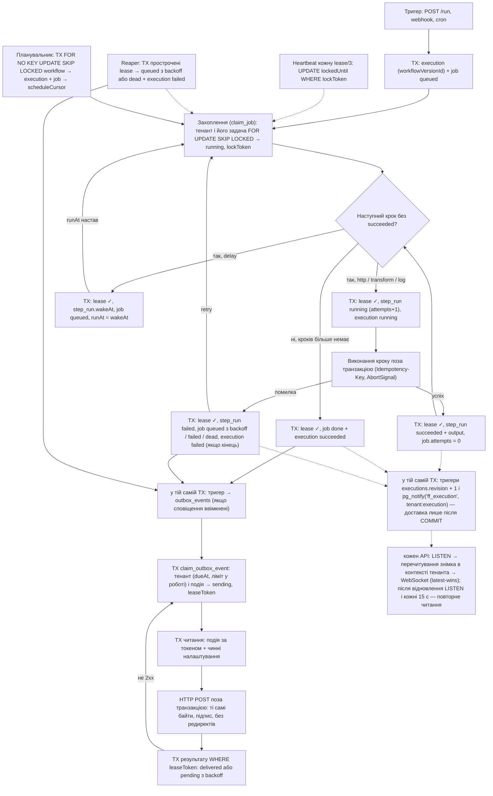

# FlowForge

Мультитенантна платформа durable workflow на PostgreSQL. Тенант описує workflow як послідовність кроків (`http`, `transform`, `log`, `delay`), а платформа виконує його рівно стільки разів, скільки треба. Гарантія тримається, коли воркер падає, інстансів кілька, а сусідній тенант перевантажує систему чи намагається вийти за межі свого тенанта.

Вимоги — у [технічному завданні](ЗАВДАННЯ.md). Детальний довідник оператора — [docs/operations.md](docs/operations.md), повні записи рішень і плани запитів — [docs/architecture.md](docs/architecture.md). HTTP API описано в OpenAPI (`/docs`, `/docs-json`).

## Зміст

- [Склад](#склад)
- [Запуск](#запуск)
- [Інтерфейс тенанта](#інтерфейс-тенанта)
- [Межа довіри браузера](#межа-довіри-браузера)
- [Протокол WebSocket](#протокол-websocket)
- [Тести](#тести)
- [Знайдені проблеми](#знайдені-проблеми)
- [Зміни наявних тестів](#зміни-наявних-тестів)
- [Архітектурні рішення](#архітектурні-рішення)
- [Модель гарантій виконання](#модель-гарантій-виконання)
- [Потік виконання і межі транзакцій](#потік-виконання-і-межі-транзакцій)
- [Індекси і плани запитів](#індекси-і-плани-запитів)
- [Chaos- і навантажувальні сценарії](#chaos--і-навантажувальні-сценарії)
- [Що не встигли або зробили б інакше](#що-не-встигли-або-зробили-б-інакше)

## Склад

| Компонент | Що робить |
|---|---|
| `apps/api` — NestJS 10 | HTTP API, WebSocket `/realtime`, планувальник cron; той самий код запускає окремий процес-воркер (`dist/worker.js`) з виконавцями кроків і відправником сповіщень |
| PostgreSQL 16 | черга задач, стан виконань і чекпоінти, RLS-ізоляція тенантів, ліміти, outbox, `LISTEN/NOTIFY` для real-time |
| `apps/frontend` — Next.js 14 (App Router) | інтерфейс тенанта; власний Node-сервер з довіреним IP клієнта, проксі до API й WebSocket |
| `docker-compose.yml` | `postgres`, `migrate`, два `api`, два `worker`, `frontend`; `docker-compose.chaos.yml` додає контрольований отримувач `sink` |

Брокерів немає: черга, таймери, fan-out між інстансами й outbox — лише PostgreSQL (ТЗ, розд. 2).

## Запуск

```bash
cp .env.example .env
docker compose up --build
```

Для локальної розробки цього досить. `.env.example` містить заглушки секретів, які дозволені лише поза `NODE_ENV=production`, а compose відкриває порти тільки на `127.0.0.1` (`PUBLISH_ADDRESS`). Під час старту з заглушками процеси пишуть у журнал попередження.

**Production.** У `.env` (права `chmod 600 .env`) задайте:

- `NODE_ENV=production` — з будь-якою заглушкою `migrate`, API й воркери не стартують;
- `ADMIN_TOKEN`, `POSTGRES_PASSWORD`, `API_DB_PASSWORD`, `WORKER_DB_PASSWORD` — випадкові значення, напр. `openssl rand -hex 24` (паролі БД — лише літери й цифри, щонайменше 24);
- `PUBLISH_ADDRESS` — адреса, на якій compose відкриває API та інтерфейс за TLS-проксі, `PUBLIC_ORIGIN=https://<домен>` і `COOKIE_SECURE=true`.

`POSTGRES_PASSWORD` діє лише під час створення порожнього тому `pgdata`: змінити його пізніше можна лише в самій БД ([docs/operations.md](docs/operations.md), «Оновлення з попередньої версії»).

Порядок старту: `postgres` → `migrate` (міграції власником схеми й створення runtime-ролей без `BYPASSRLS`) → `api`, `api-2`, два `worker` (кожен перевіряє на старті, що його роль не обходить RLS) → `frontend`. Схема будується лише міграціями, тож система піднімається з порожнього тому. Кожен сервіс отримує лише свої секрети.

| Сервіс | Адреса |
|---|---|
| Інтерфейс | http://localhost:3001 |
| API, Swagger UI | http://localhost:3000, http://localhost:3000/docs |
| Метрики | API — `http://api:3200/metrics`, воркери — `:3100/metrics` (лише в мережі compose) |
| Postgres | `127.0.0.1:5432` |

Інші порти задають `API_PORT`, `FRONTEND_PORT`, `POSTGRES_PORT` у `.env`. Запуск без Docker, оновлення з попередньої версії, усі змінні оточення й міграції описано в [docs/operations.md](docs/operations.md).

### Приклади запитів

```bash
ADMIN_TOKEN="$(sed -n 's/^ADMIN_TOKEN=//p' .env)"
curl -X POST localhost:3000/tenants -H "x-admin-token: $ADMIN_TOKEN" \
  -H 'content-type: application/json' -d '{"name":"acme"}'
```

Відповідь містить `apiKey` (показується один раз) і `webhookSecret`. Далі — заголовок `x-api-key`; необов'язковий `x-request-id` задає кореляційний ID.

```bash
API_KEY=ff_...
curl -X POST localhost:3000/workflows -H "x-api-key: $API_KEY" -H 'content-type: application/json' \
  -d '{"name":"demo","steps":[{"id":"hello","type":"log","message":"hi {{ input.name }}"}]}'
curl -X POST localhost:3000/workflows/<workflowId>/run -H "x-api-key: $API_KEY" \
  -H 'Idempotency-Key: order-42' -H 'content-type: application/json' -d '{"name":"Ada"}'
curl "localhost:3000/executions?status=succeeded&limit=20" -H "x-api-key: $API_KEY"
curl localhost:3000/executions/<executionId> -H "x-api-key: $API_KEY"
```

Повтор запуску з тим самим `Idempotency-Key` повертає те саме виконання (200, перший запит — 201). Виконання `failed` продовжується з першого незавершеного кроку: `POST /executions/:id/retry`.

| Метод | Шлях | Опис |
|---|---|---|
| POST | `/tenants` | створення тенанта (`x-admin-token`, необов'язково `limits`) |
| GET/PATCH | `/tenants/:id/limits` | ліміти тенанта: перевизначення й ефективні значення |
| GET/POST | `/workflows` | сторінка `{items, nextCursor}` (`limit` 1..100) і створення |
| GET/PATCH/DELETE | `/workflows/:id` | значення заголовків — `{"stored":true}`; у PATCH `{"keep":true}` лишає збережене |
| POST | `/workflows/:id/run` | запуск, `Idempotency-Key` |
| GET | `/executions` | сторінка за курсором, фільтри `status`, `workflowId`, `limit` 1..200 |
| GET | `/executions/:id`, `…/summary`, `…/steps/:i`, `…/output` | повні дані, знімок без виходів, один крок, вхід і результат |
| POST | `/executions/:id/retry`, `/executions/:id/realtime-tickets` | повтор `failed`; одноразовий тикет WebSocket |
| POST/DELETE | `/sessions`, `/sessions/current` | сесія браузера в обмін на ключ і її відкликання |
| POST | `/hooks/:workflowId` | вхідний webhook (підпис v1 з часом і ID доставки) |
| GET/PUT/DELETE, POST | `/tenants/me/notifications…`, `/tenants/me/webhook-secrets…` | сповіщення, журнал подій, ротація ключів |
| GET | `/health`, `/ready` | liveness і доступність БД |

Відповіді лімітів: `429 rate_limited` з `Retry-After`; `429 queue_full` і `429 workflow_limit_reached` без нього (місце звільняє завершення задач чи видалення workflow). Під лімітом частоти кожна відповідь несе `X-RateLimit-Limit`, `X-RateLimit-Remaining`, `X-RateLimit-Reset`.

## Інтерфейс тенанта

Відкрийте http://localhost:3001 і введіть `apiKey` тенанта. Інтерфейс покриває щоденний сценарій: знайти чи створити workflow, відредагувати кроки й розклад (`cron`, таймзона IANA, `missedRunPolicy`), запустити, знайти виконання за статусом і workflow, простежити кроки наживо й зрозуміти результат або причину помилки. Повтор `failed` — кнопкою на сторінці виконання.

- Форма перевіряє визначення тим самим контрактом, що й API (zod; паритет доводить `test/contract.spec.ts`). Помилки сервера показуються біля відповідних полів, зокрема `schedule: …` — біля cron і таймзони. Розклад показує `scheduleError` і `scheduleBlockedSince`.
- Заголовки відображаються маркером «Збережено» з діями «Замінити» і «Видалити». Збереження через браузер перевіряє ревізію всього процесу. Після конфлікту форма зберігає введені дані й пропонує завантажити актуальну конфігурацію. Зміна URL вимагає повторно ввести або видалити збережені заголовки.
- Списки підвантажують сторінки за курсором. Зміна фільтра скидає курсор, а запізніла відповідь попереднього фільтра відкидається. Після відновлення зв’язку список зберігає завантажені рядки й повторює перерваний запит за його курсором. Короткий ID у рядку допомагає розрізнити виконання одного процесу, запущені одночасно.
- Стани завантаження, порожнього результату, помилки, втрати зв'язку й відновлення; доступні мітки, видимий фокус, керування з клавіатури; статуси розрізняються й текстом.

### Фронтенд: повтор після невизначеної відповіді

Якщо мережа обірвалась після надсилання, запуск можна повторити з тим самим `Idempotency-Key`. Форма передає введений JSON до API без зміни числових значень. PATCH з тією самою ревізією приймається лише доти, доки конфігурація актуальна. Повтор однакового визначення не створює знімок кроків. При конфлікті або невідомому результаті форма пропонує перевірити поточний стан. Для створення процесу після невідомого результату форма пропонує перевірити список. Введене зберігається до виходу з редактора.

## Межа довіри браузера

- **Вхід.** Сервер фронтенду обмінює введений ключ на відкличну сесію (`POST /sessions`). Ключ живе лише в одному серверному запиті. Браузер отримує httpOnly cookie з непрозорим токеном, PostgreSQL зберігає лише його SHA-256. Строк дії абсолютний (`SESSION_TTL_MS`, типово 8 год), на тенанта до `SESSION_MAX_PER_TENANT` сесій. Вхід іншим ключем відкликає попередню сесію браузера.
- **Вихід** відкликає сесію в API, прибирає cookie, закриває WebSocket-підписки цієї сесії (`NOTIFY` на всі інстанси) і повідомляє інші вкладки (`BroadcastChannel`). Окрема квота відкликання становить 60 запитів за хвилину на тенанта, спільно для всіх інстансів API. Запит враховується в цій квоті після автентифікації браузерної сесії.
- **Проксі** пропускає лише маршрути інтерфейсу, перевіряє `Origin` для змін стану, обмежує тіло (256 КіБ) і час (`API_TIMEOUT_MS`). Він передає статус, тіло помилки, `Retry-After`, `X-RateLimit-*` і `x-request-id` без змін. Відповіді — `Cache-Control: private, no-store`, сторінки рендеряться на кожен запит, а зміна сесії — повна навігація, тож дані тенантів не змішуються в кешах.
- **IP клієнта.** Next 14 зберігає `X-Forwarded-For`, надісланий браузером, тому власний сервер (`server.ts`) обчислює адресу із сокета й довірених проксі (`FRONTEND_TRUST_PROXY`) і перезаписує заголовок до того, як запит побачить Next. API довіряє `X-Forwarded-For` лише від адреси фронтенду (`TRUST_PROXY`). Ліміти невдалих входів рахуються окремо для кожного клієнта, а довільне значення від браузера не стає довіреним IP.
- **Режими.** Локальний Compose — `http://localhost:3001`, `COOKIE_SECURE=false`, cookie `ff_session`. За TLS задайте `PUBLIC_ORIGIN=https://<домен>` і `COOKIE_SECURE=true` (cookie `__Host-ff_session`), а `FRONTEND_TRUST_PROXY` — адресою TLS-термінатора.

## Протокол WebSocket

1. Власник виконання робить `POST /executions/{id}/realtime-tickets` і отримує `{ticket, expiresAt}`. Тикет одноразовий і живе 30 с (`REALTIME_TICKET_TTL_MS`), його область — одне виконання цього тенанта й ця сесія.
2. Браузер відкриває `wss://<домен>/realtime?ticket=<ticket>` на origin фронтенду. Фронтенд перевіряє `Origin` і з'єднує сокет із будь-яким інстансом API. API атомарно погашає тикет у PostgreSQL ще до upgrade: недійсний, прострочений чи повторний тикет — HTTP 401, ліміт — 429 з `Retry-After`.
3. Сервер надсилає `{"type":"snapshot","execution":…}` — повний знімок у формі `GET /executions/{id}/summary`, без виходів кроків. Ревізія — десятковий рядок bigint, вона зростає під блокуванням рядка виконання в порядку COMMIT. Клієнт замінює знімок за більшою ревізією. За тієї самої ревізії чинний WebSocket або резервне послідовне опитування можуть оновити назву workflow.
4. Кожні 15 с приходить `{"type":"heartbeat"}`; тиша понад 45 с означає мертве з'єднання. Клієнт нічого не надсилає (будь-яке повідомлення — закриття 1003).
5. Коди закриття: 4401 — сесію відкликано чи вона сплила, 4404 — виконання недоступне, 4008 — повільний споживач, 1013 — повторіть пізніше, 1001 — інстанс завершується.
6. **Відновлення.** Джерело істини — БД, а сповіщення лише будять читача. Підписка реєструється до читання знімка, тож зміна між читанням і підпискою не губиться. Після відновлення `LISTEN` (обрив, рестарт БД, невдала перевірка живості) і кожні 15 с API перечитує всі підписки. Клієнт перепідключається з backoff і jitter (0,5…30 с) з новим тикетом, а після трьох невдач паралельно опитує `summary`. Кожен запит тикета або знімка має браузерний таймаут 30 с.
7. **Ресурси.** На інстанс до 256 підписок, на тенанта до 32. Черга повідомлень сокета — один слот (новий знімок замінює старий), буфер до 256 КіБ. Перехід зі сторінки закриває сокет, таймери й незавершене отримання тикета.

**Чому WebSocket, а не SSE.** Обидва передали б ті самі знімки, і обидва потребують перечитування БД після розриву. WebSocket дає відмову до відкриття потоку (тикет погашається до upgrade з кодом 401 чи 429) і явні коди закриття для сесії та повільного споживача. Перепідключенням керує клієнт. `EventSource` перепідключається сам на початковий URL з уже погашеним одноразовим тикетом і не дозволяє передати заголовок авторизації.

## Тести

```bash
cd apps/api
npm test                    # unit (без БД)
# тестова БД — власником; пароль — POSTGRES_PASSWORD із кореневого .env (без нього — flowforge, як у CI)
pw="$(node -e 'const {parseEnv}=require("node:util"), {existsSync, readFileSync}=require("node:fs");
  const f="../../.env"; process.stdout.write((existsSync(f) && parseEnv(readFileSync(f,"utf8")).POSTGRES_PASSWORD) || "")')"
export TEST_DATABASE_URL="postgres://flowforge:${pw:-flowforge}@localhost:5432/flowforge_test"
npm run test:integration    # integration на реальному Postgres (спершу збирає dist: тест падіння воркера запускає dist/worker.js)
npm run test:all            # обидва набори
```

Браузерні тести (Playwright, Chromium) — проти стеку з оверлеєм `sink`, з `apps/frontend`:

```bash
set -a && . ../../.env && set +a
API_ORIGIN=http://localhost:3000 FRONTEND_ORIGIN=http://localhost:3001 npx playwright test
```

| Набір | Що доводить |
|---|---|
| unit (`apps/api/test/unit`) | backoff і jitter, валідацію визначень, пісочницю `transform`, підпис webhook, наступне спрацювання cron у різних зонах і на переходах DST, межі конфігурації |
| integration (`apps/api/test/integration`, реальний PostgreSQL) | N воркерів × M задач — кожна рівно один раз; вбитий посеред кроку воркер — задачу підхоплено без повтору завершених кроків і з одним зовнішнім ефектом; два планувальники — одне спрацювання; тенант A не бачить і не змінює даних B, зокрема прямим SQL під RLS; SSRF, вихід із пісочниці, повторна доставка й змінене тіло webhook; курсори, квоти, тикети й обрив `LISTEN` на двох інстансах API |
| браузер (`apps/frontend/test`) | сценарій тенанта на production-збірці зі зупинкою інстансу API посеред виконання, відсутність витоків сокетів і опитування, автомат підписки, паритет форми й API |

CI (`.github/workflows/ci.yml`) запускає форматування, лінт, типи, unit, integration на PostgreSQL 16, бенчмарк захоплення, збірки, Compose із двома воркерами, chaos- і навантажувальні сценарії та браузерні тести.

## Знайдені проблеми

Дефекти, закладені в стартовому коді (ТЗ 3.2). Кожен відтворено автоматизованим тестом (червоний до виправлення, зелений після) і виправлено.

### Ізоляція даних між тенантами

#### 1. `GET /executions/:id` віддавав виконання іншого тенанта

- **Що.** `ExecutionsService.get(id)` шукав виконання й кроки лише за `id`, без тенанта з ключа.
- **Чому небезпечно.** Будь-який тенант читав вхід, результати кроків і помилки чужих виконань, знаючи або перебираючи їхні ID.
- **Як відтворити.** `tenant-isolation-api.int-spec.ts`: ключ тенанта B проти виконання A отримував 200 з даними A.
- **Як виправлено.** Предикат тенанта в кожному запиті плюс Row-Level Security з `FORCE` під роллю без `BYPASSRLS` (рішення 3.3.4). Чуже виконання — 404. Тест перевіряє й прямі SQL-запити в обхід сервісів.
- **Альтернативи.** 403 замість 404 підтверджував би існування чужого ID. Guard власника на кожному маршруті без RLS лишав би ізоляцію на дисципліні коду.

### Тести, що проходять незалежно від поведінки

#### 2. Тест ізоляції тенантів для виконань нічого не перевіряв

- **Що.** `test/executions.service.spec.ts` обіцяв ізоляцію тенантів, але працював з моком репозиторію й перевіряв лише, що мок повернув підготовлене значення.
- **Чому небезпечно.** CI зелений, хоча фільтра за тенантом могло не бути. Дефект №1 жив саме під таким тестом.
- **Як відтворити.** Мутація: прибрати `tenantId` з умови `ExecutionsService.list` — тест лишається зеленим.
- **Як виправлено.** Замінено інтеграційним `executions-tenant-isolation.int-spec.ts` на реальному PostgreSQL з двома тенантами. Та сама мутація робить його червоним.
- **Альтернативи.** Перевіряти аргументи виклику мока — тест знову перевіряв би реалізацію, а не результат запиту.

### Коректність черги задач за кількох воркерів

#### 3. Одну задачу захоплювали кілька воркерів

- **Що.** `claimNext` робив `SELECT id … LIMIT 1`, а потім окремий `UPDATE` без блокування.
- **Чому небезпечно.** Два воркери брали ту саму задачу, і кроки виконувались двічі. Для `http` це повторні платежі й листи.
- **Як відтворити.** `queue-claim.int-spec.ts`: три воркери з окремими пулами над M задачами — частина задач виконана понад один раз.
- **Як виправлено.** Вибір і захоплення — один оператор `UPDATE … WHERE id = (SELECT … FOR UPDATE SKIP LOCKED) RETURNING`, кожне захоплення видає новий fencing-токен. Тест N воркерів × M задач підтверджує рівно одне виконання кожної.
- **Альтернативи.** `pg_try_advisory_lock` після `SELECT` — блокування живе на сесії з'єднання, яке воркер не тримає під час HTTP-кроку.

#### 4. Виконання ставало `succeeded`, поки задача лишалась незавершеною

- **Що.** Завершення оновлювало `executions` і `jobs` окремими запитами; так само провал і повтор.
- **Чому небезпечно.** Падіння процесу між запитами лишало виконання `succeeded` із задачею `running`, і її виконували ще раз (ТЗ, розд. 4).
- **Як відтворити.** `execution-atomicity.int-spec.ts`: тригер БД обриває друге оновлення — стан розходиться.
- **Як виправлено.** Кожна зміна кількох таблиць — одна транзакція, що починається з перевірки володіння задачею за fencing-токеном.
- **Альтернативи.** Ідемпотентно «доводити» стан під час наступного захоплення — проміжний стан однаково видно клієнтам.

### Поведінка при аварійному завершенні воркера

#### 5. Задачу воркера, що впав, ніхто не повертав у чергу

- **Що.** Захоплення ставило `lockedUntil`, але жоден код його не перевіряв.
- **Чому небезпечно.** Після OOM, SIGKILL чи падіння вузла задача назавжди лишалась у `running`, а виконання — завислим.
- **Як відтворити.** `queue-recovery.int-spec.ts`: задача в стані, який лишає вбитий воркер, не поверталась.
- **Як виправлено.** Lease з heartbeat і reaper: прострочену задачу повертають у чергу з backoff, а після вичерпання спроб — у `dead`. Fencing не дає «воскреслому» воркеру нічого записати. `worker-crash.int-spec.ts` вбиває процес посеред кроку: задачу підхоплено, завершені кроки не повторено, зовнішній ефект — один.
- **Альтернативи.** Advisory-лок на сесію воркера звільняється сам, але потребує окремого з'єднання на кожну задачу.

#### 6. Завершення воркера лишало задачі в `running`

- **Що.** `onApplicationShutdown` лише ставив прапорець, а пул з'єднань закривався, поки кроки ще йшли.
- **Чому небезпечно.** Кожен деплой (SIGTERM) губив або затримував поточні виконання.
- **Як відтворити.** `worker-shutdown.int-spec.ts`.
- **Як виправлено.** `beforeApplicationShutdown` припиняє нові захоплення, чекає поточні кроки до `WORKER_SHUTDOWN_GRACE_MS` і повертає незавершені задачі в чергу.
- **Альтернативи.** Чекати без межі — оркестратор однаково вб'є процес після свого таймауту.

### Властивості виконання

#### 7. Повтор задачі заново виконував уже завершені кроки

- **Що.** Кожна спроба проходила workflow з першого кроку й створювала нові `step_runs`.
- **Чому небезпечно.** Помилка на кроці N повторювала побічні ефекти кроків 1..N-1.
- **Як відтворити.** `durable-execution.int-spec.ts`: `charge` (успіх) → `fail` (помилка) → повтор знову викликав `charge`.
- **Як виправлено.** Чекпоінт — рівно один рядок `step_runs` на крок. Повтор продовжує з першого незавершеного кроку й бере збережені результати. Крок `http` у кожній спробі надсилає той самий `Idempotency-Key`.
- **Альтернативи.** Увесь контекст одним JSON у `executions` — один рядок, але кожен чекпоінт переписує весь стан.

#### 8. Виконання, що вже стартувало, слідувало за пізнішими змінами workflow

- **Що.** Воркер читав кроки з `workflows` у момент обробки.
- **Чому небезпечно.** Виконання проходило частину кроків старої версії й частину нової.
- **Як відтворити.** `durable-execution.int-spec.ts`: змінити кроки після створення виконання — воно виконує нові.
- **Як виправлено.** Незмінні знімки `workflow_versions`; виконання посилається на версію, зафіксовану на старті.
- **Альтернативи.** Копіювати кроки в кожне виконання — дублювання визначень на кожен запуск.

#### 9. `delay` тримав слот воркера, а перезапуск починав паузу заново

- **Що.** Пауза — `setTimeout` у воркері.
- **Чому небезпечно.** Довгі паузи займали всі слоти, і черга стояла. Після рестарту пауза починалась спочатку.
- **Як відтворити.** `durable-timers.int-spec.ts`: один слот і пауза — інші задачі не виконуються; рестарт подовжує паузу.
- **Як виправлено.** Момент пробудження фіксується в БД за годинником БД, задача повертається в чергу з `runAt = wakeAt` і слота не тримає.
- **Альтернативи.** Окремий процес таймерів — ще один компонент з тією самою потребою у відновленні.

### Безпека виконання кроків

#### 10. `transform` виконував довільний JavaScript на хості

- **Що.** Вираз виконувався через `new Function('ctx', …)` у процесі воркера.
- **Чому небезпечно.** Тенант виконував код із правами воркера: читав оточення й секрети, мережу, файли.
- **Як відтворити.** `transform.spec.ts`: вираз із викликом функції JavaScript виконувався, а результат понад 64 КіБ приймався.
- **Як виправлено.** Обмежена мова виразів (профіль JSONata) з перевіркою дерева виразу, в окремому процесі з лімітами часу, пам'яті й розміру результату (рішення 3.3.6). `transform-runtime.int-spec.ts` перевіряє вихід із пісочниці.
- **Альтернативи.** `vm`/`isolated-vm` з довільним JS — більша поверхня атаки й нативна залежність.

#### 11. Крок `http` діставав внутрішню мережу й читав відповідь без межі

- **Що.** `fetch` за адресою тенанта без перевірки IP, з автоматичними редиректами, і `res.text()` без межі розміру.
- **Чому небезпечно.** SSRF до loopback, приватних мереж і службових адрес хмар (`169.254.169.254`), зокрема через редирект чи підміну DNS. Велика відповідь вичерпувала пам'ять воркера.
- **Як відтворити.** `step-policy.spec.ts` отримував 200 від фікстури на непублічній адресі; `outbound-address.int-spec.ts` перебирає loopback, приватні діапазони, IPv4-mapped IPv6 і редиректи.
- **Як виправлено.** Перевірка IP після резолву на рівні з'єднання (`undici`), редиректи вручну з повторною перевіркою кожного переходу, таймаут і ліміт фактично прочитаних байтів.
- **Альтернативи.** Перевірка лише URL до запиту не захищає від DNS rebinding і редиректів.

### Автентичність і повторна доставка webhook-ів

#### 12. Підпис webhook перевірявся над повторно серіалізованим JSON і без вікна часу

- **Що.** HMAC рахувався від `JSON.stringify(body)` після розбору, порівнювався через `!==`, а часу й ідентифікатора доставки не було.
- **Чому небезпечно.** Правильно підписані тіла з іншим форматуванням відхилялись, порівняння давало часовий канал, а перехоплений запит можна було повторювати безкінечно.
- **Як відтворити.** `webhook-input.int-spec.ts`: коректний HMAC точних байтів із пробілами — 401 замість 202; `webhook-signature.spec.ts`.
- **Як виправлено.** HMAC над сирими байтами з префіксом `v1`, часом і ID доставки; `timingSafeEqual`; вікно ±300 с; два активні секрети для ротації без простою.
- **Альтернативи.** Канонізувати JSON перед підписом — відправник мусив би повторювати саме нашу канонізацію.

#### 13. Повторна доставка тієї самої події створювала друге виконання

- **Що.** Кожен валідний запит створював нове виконання.
- **Чому небезпечно.** Повтор відправника після таймауту дублював бізнес-дію.
- **Як відтворити.** `webhook-input.int-spec.ts` на PostgreSQL: дві доставки — два виконання й дві задачі.
- **Як виправлено.** Квитанція доставки з унікальним ключем у тій самій транзакції, що й постановка; повтор повертає те саме `executionId`, а той самий ID з іншим тілом — 409.
- **Альтернативи.** Перевірка в пам'яті процесу не переживає рестарту й не працює на кількох інстансах.

### Планувальник

#### 14. Кожен інстанс API дублював спрацювання розкладу

- **Що.** Кожен процес незалежно створював виконання для тих самих моментів.
- **Чому небезпечно.** N інстансів — N запусків на момент (ТЗ 3.3.8).
- **Як відтворити.** Два `SchedulerService` над `* * * * * *` за 3 с — 6 виконань замість 3; `scheduler-instances.int-spec.ts`.
- **Як виправлено.** Блокування рядка workflow (`FOR NO KEY UPDATE SKIP LOCKED`) і курсор розкладу в тій самій транзакції, що й створення виконання; унікальний індекс `(tenant, workflow, scheduledAt)` — страховка.
- **Альтернативи.** Лідер через advisory-лок — один інстанс робить усю роботу, а зміна лідера має вікно без спрацювань.

#### 15. Прогрес планувальника жив у пам'яті процесу

- **Що.** Поле `lastTick` у пам'яті: після рестарту відлік починався з моменту старту.
- **Чому небезпечно.** Усі спрацювання за час простою губились мовчки.
- **Як відтворити.** `scheduler-progress.int-spec.ts` › restart: очікувані моменти простою — не створено жодного.
- **Як виправлено.** Курсор у рядку workflow оновлюється в транзакції спрацювання. Пропущені моменти обробляє політика `skip` / `run_once` / `run_all` з верхньою межею.
- **Альтернативи.** Окрема таблиця спрацювань — та сама гарантія, але більше рядків на кожен момент.

#### 16. Розклад обчислювався в таймзоні процесу

- **Що.** `workflow.timezone` зберігалось, але не передавалось у `cron-parser`.
- **Чому небезпечно.** `0 9 * * *` у `Europe/Kyiv` спрацьовував о 09:00 таймзони контейнера, а після переходу на літній час зсув змінювався ще раз.
- **Як відтворити.** `scheduler-timezone.int-spec.ts`: розклад у поточну годину зони workflow — 0 спрацювань.
- **Як виправлено.** Моменти обчислюються в зоні workflow з перевіркою IANA. Unit-тести покривають переходи DST із заздалегідь визначеними моментами.
- **Альтернативи.** Зберігати розклад у UTC — користувач мусив би сам переводити час і перераховувати його на кожен перехід DST.

### Клієнтський код, що з часом деградує

#### 17. Сторінка виконання не зупиняла опитування після виходу з неї

- **Що.** `setInterval` у `useEffect` без очищення, без скасування запитів і без порядку відповідей.
- **Чому небезпечно.** Кожне відкриття сторінки додавало вічний таймер і запит щосекунди; повільні відповіді накладались, а старіша могла затерти новіший стан.
- **Як відтворити.** `apps/frontend/test/execution-unmount.spec.ts` на стартовому фронтенді: після клієнтського переходу зі сторінки запити до виконання тривають.
- **Як виправлено.** Підписка через WebSocket із ревізією знімка, новим тикетом на кожну спробу, backoff, watchdog і резервним опитуванням. Unmount звільняє сокет, таймери, listeners і незавершені запити. Тест повертається до базового рівня після повторних відкриттів, зокрема під час перепідключення.
- **Альтернативи.** Лише додати `clearInterval` — лишається опитування без порядку відповідей і без real-time.

### Необмежене споживання ресурсів і розкриття секретів (ТЗ, розд. 4)

#### 18. Списки workflow і виконань читали повні записи без межі

- **Що.** `GET /workflows` повертав усі визначення тенанта (кожне до 64 КіБ) без пагінації, а `GET /executions` — `input` і `output` (до 1 МіБ) кожного з 200 рядків, з `limit=abc` → 500. Кількість workflow тенанта не обмежувалась.
- **Чому небезпечно.** Тенант у межах rate limit створював десятки тисяч workflow, і один запит списку вичерпував пам'ять спільного API.
- **Як відтворити.** `workflow-list.int-spec.ts`: для 30 workflow розмір відповіді зростав із 10 531 до 1 826 551 байт разом з визначеннями; `execution-list.int-spec.ts`: невалідний `limit` — 500.
- **Як виправлено.** Сторінки за курсором `(createdAt, id)` з мікросекундами й межами `limit`, поля огляду вибираються в SQL; квота `maxWorkflows`. Розмір сторінки не залежить від визначень і виходів.
- **Альтернативи.** Масив із мовчазним обрізанням — клієнт не дізнався б про решту записів.

#### 19. Значення заголовків кроку `http` поверталися у відповідях API

- **Що.** GET, POST і PATCH workflow повертали значення всіх заголовків, зокрема `Authorization` і довільні `X-*`.
- **Чому небезпечно.** Секрети тенанта потрапляли у відповіді, кеші й браузер (ТЗ, розд. 4).
- **Як відтворити.** `workflow-headers.int-spec.ts`: маркер у заголовку є у відповідях.
- **Як виправлено.** Кожна відповідь із кроками містить `{"stored":true}` замість значення. PATCH з `{"keep":true}` зберігає значення, якщо під блокуванням рядка підтверджені ревізія конфігурації та URL кроку. Воркер надсилає справжнє значення, що підтверджує контрольований отримувач.
- **Альтернативи.** Маскувати за списком назв — секрет може бути в будь-якому заголовку.

#### 20. Текст кроку `log` потрапляв в операційний журнал

- **Що.** Відрендерений шаблон, зокрема `{{ input.* }}` і відповіді попередніх кроків, ішов у журнал воркера, і маскування за шляхами його не бачило.
- **Чому небезпечно.** Дані тенанта опинялись у журналі оператора (ТЗ, розд. 4), а сам тенант свого логу не бачив.
- **Як відтворити.** `log-step-privacy.int-spec.ts`: маркер із входу й з відповіді `http` є у виводі логера воркера.
- **Як виправлено.** Текст зберігається в результаті кроку `{logged: true, message}`, доступному власнику виконання. В операційний журнал ідуть лише ID, кореляція й довжина.
- **Альтернативи.** Розширити маскування — шаблон може підставити будь-яке поле під будь-якою назвою.

### Точність даних

#### 21. HTTP-крок мовчки змінював числа у відповіді

- **Що.** `JSON.parse` у стартовому виконавці округлював великі цілі числа та перетворював числа за межами діапазону на нескінченність, яка серіалізувалася як `null`.
- **Чому небезпечно.** Змінений ідентифікатор або сума потрапляли в збережений результат і могли використатися в наступному кроці.
- **Як відтворити.** Контрольований отримувач повертає JSON із числами `9007199254740993` і `1e400`. Стартовий виконавець успішно повертає `9007199254740992` і `null`. `test/unit/step-text-response.spec.ts` перевіряє відмову для неточних чисел і збереження точних.
- **Як виправлено.** Валідну JSON-відповідь перевіряємо тим самим засобом збереження точності, що й тіло запиту API. Неточне число дає неповторювану помилку до запису результату.
- **Альтернативи.** Довільна точність потребувала б зміни типів по всьому рушію. Перетворення на рядок змінювало б тип отриманого значення.

## Зміни наявних тестів

Тести стартового коду змінено лише там, де вони не перевіряли заявлену поведінку або де поведінку змінено вимогою ТЗ.

| Тест | Зміна | Чому |
|---|---|---|
| `test/definition.spec.ts`, `test/template.spec.ts`, `test/job-queue.spec.ts` | перенесено в `test/unit/`, оновлено шляхи імпорту й форматування; додано нові випадки | розділення unit і integration; наявні перевірки збережено |
| `test/executions.service.spec.ts` | замінено на `test/integration/executions-tenant-isolation.int-spec.ts` | тест не перевіряв ізоляції (проблема 2) |
| `test/unit/job-queue.spec.ts` › «grows exponentially with the attempt number» | точні значення `2^n` замінено перевірками діапазону, jitter і верхньої межі | ТЗ 3.3.1 вимагає backoff з jitter; детермінована формула більше не діє |
| `test/unit/job-queue.spec.ts` › два `it.todo` | прибрано | поведінку доводять інтеграційні тести на PostgreSQL (`queue-claim`, `queue-recovery`) |
| `test/integration/workflow-headers.int-spec.ts` | перевірка конкурентного збереження тепер очікує 409, запити з `keep` передають `editRevision` | актуальна ревізія гарантує, що приховане значення береться з визначення, яке бачив редактор |
| `test/integration/scheduler-missed.int-spec.ts` | перевірка службового часу виконується в БД, відповідь API перевіряється окремо | підказка наступного тіку не є розрахованою датою запуску |
| `test/integration/connection-pool.int-spec.ts` | lease 3 с, HTTP-крок триває 9 с, штучна затримка SQL й перевірки повторів збережені | при lease 1,5 с виміряні затримки підтвердження heartbeat на спільному раннері перевищували захисний бюджет; крок і далі вимагає кількох продовжень |
| `test/integration/execution-realtime.int-spec.ts` | тест перериває свій LISTEN за PID і перевіряє зʼєднання в сусідній БД | перевірка відновлення не повинна залежати від інших баз одного кластера |
| `apps/frontend/test/tenant-journey.spec.ts` | після відновлення API тест чекає на `/ready` | наступний браузерний сценарій має працювати з відновленим API |

## Архітектурні рішення

Короткі записи для ТЗ 3.3.1–3.3.11 і вибору технологій. Повні міркування, межі й експерименти — [docs/architecture.md](docs/architecture.md).

### Стек (ТЗ, розд. 2)

TypeORM-міграції замість `synchronize`; `@nestjs/config` з валідацією; `nestjs-pino` з маскуванням секретів і кореляцією через `AsyncLocalStorage`; `prom-client`; `@nestjs/terminus`; `@nestjs/throttler` зі сховищем у PostgreSQL; JSONata з обмеженням часу; `undici` + `ipaddr.js` для SSRF; `@nestjs/platform-ws` для WebSocket; `@nestjs/swagger`; zod на фронтенді; Playwright для браузерних тестів. Redis і брокери не використовуються.

### 3.3.1 Надійна черга

- **Варіанти:** `FOR UPDATE SKIP LOCKED`, lease у рядку задачі, advisory-локи.
- **Обрано:** захоплення одним `UPDATE … SKIP LOCKED RETURNING`, lease з heartbeat і fencing-токеном, reaper прострочених lease. Повтори — експоненційний backoff із jitter і верхньою межею; помилки поділено на повторювані (мережа, 408/425/429/5xx) і неповторювані; після `JOB_MAX_ATTEMPTS` задача переходить у `dead`. Graceful shutdown повертає незавершені задачі в чергу.
- **Чому:** advisory-локи прив'язані до сесії з'єднання, а воркер не тримає з'єднання під час HTTP-кроку. Lease видно в БД, і він переживає перепідключення.
- **Обмеження:** порожня черга опитується з інтервалом `WORKER_POLL_INTERVAL_MS` (з jitter), а не будиться `NOTIFY`.

### 3.3.2 Durable execution

- **Варіанти:** чекпоінт кожного кроку окремим рядком; увесь контекст одним JSON; event sourcing.
- **Обрано:** рядок `step_runs` на крок, записаний в одній транзакції з перевіркою володіння задачею. Повтор продовжує з першого незавершеного кроку. `Idempotency-Key` кроку `http` стабільний для всіх спроб. Виконання працює зі знімком `workflow_versions`.
- **Чому:** найменший запис на крок і пряма видимість стану кожного кроку для API.
- **Обмеження:** зовнішній ефект `http` — щонайменше один раз; ефективно один раз — лише якщо отримувач враховує `Idempotency-Key`.

### 3.3.3 Довговічні таймери

- **Варіанти:** `setTimeout` у воркері; окремий процес таймерів; задача з відкладеним `runAt`.
- **Обрано:** момент пробудження фіксується за годинником БД, а задача повертається в чергу з `runAt = wakeAt`.
- **Чому:** таймер — та сама черга з тими самими гарантіями відновлення, слота воркера він не тримає.
- **Обмеження:** точність пробудження — інтервал опитування черги; найдовша пауза — 30 днів.

### 3.3.4 Ізоляція тенантів у глибину

- **Варіанти:** схема чи БД на тенанта; RLS; лише фільтри в коді.
- **Обрано:** предикат тенанта в кожному запиті плюс RLS з `FORCE` під ролями без `BYPASSRLS`, контекст `set_config('app.tenant_id', …, true)` у транзакції. Крос-тенантні операції — лише вузькі `SECURITY DEFINER`-функції. Перевірка інваріантів на старті відмовляється працювати з чужими ролями, грантами чи політиками. Ліміти тенанта: одночасні виконання, розмір черги, частота запитів (API й webhook окремо), кількість workflow — з `CHECK` у БД і адмін-API.
- **Чому:** RLS захищає й від запиту, що оминув шар сервісів. Тест доводить, що запит без контексту тенанта нічого не бачить.
- **Обмеження:** RLS захищає від помилок коду, а не від скомпрометованого процесу FlowForge.

### 3.3.5 Справедливе планування

- **Варіанти:** FIFO за `runAt`; round-robin; вибір тенанта з найменшою кількістю задач у роботі.
- **Обрано:** облік `tenant_usage` (готові, у роботі, межа), вибір готового тенанта з найменшою кількістю задач у роботі й найдавнішим захопленням, далі — його найраніша задача. Обидва кроки використовують `SKIP LOCKED` за частковими індексами.
- **Чому:** вартість захоплення не залежить від глибини черги одного тенанта. Вимірювання — у [сценаріях](#chaos--і-навантажувальні-сценарії).
- **Обмеження:** пропускна здатність захоплення на бенчмарку становить близько 60% від FIFO — це ціна справедливості.

### 3.3.6 Безпечне виконання кроків

- **Варіанти:** `vm`/`isolated-vm` з JS; обмежена мова виразів; WebAssembly-пісочниця.
- **Обрано:** профіль JSONata з перевіркою дерева виразу в окремому дочірньому процесі з лімітами часу, пам'яті й розміру результату; шаблонізатор читає лише власні поля дозволених коренів. `http` перевіряє IP після резолву на рівні з'єднання, редиректи обробляються вручну, діють таймаут і межа байтів.
- **Чому:** мова без доступу до хоста закриває клас атак, а не окремі сценарії.
- **Обмеження:** `transform` підтримує підмножину JSONata.

### 3.3.7 Вхідні webhook-и

- **Варіанти:** HMAC над тілом; канонізований JSON; підписаний JWT.
- **Обрано:** HMAC-SHA256 над `v1\n<workflow>\n<час>\n<ID доставки>\n` і сирими байтами тіла, `timingSafeEqual`, вікно ±300 с, квитанція доставки в транзакції постановки, два активні ключі для ротації без простою.
- **Чому:** відправник підписує ті самі байти, що надсилає; повтор і підміна тіла виявляються.
- **Обмеження:** годинник відправника має бути в межах вікна.

### 3.3.8 Планувальник

- **Варіанти:** лідер через advisory-лок; унікальний запис спрацювання; блокування рядка розкладу.
- **Обрано:** блокування рядка workflow (`FOR NO KEY UPDATE SKIP LOCKED`), курсор розкладу й виконання в одній транзакції, унікальний індекс як страховка. Моменти обчислюються в зоні workflow. Пропущені моменти обробляє політика `skip` / `run_once` / `run_all` з верхньою межею, а повна черга відкладає спрацювання (`scheduleBlockedSince`).
- **Чому:** працюють усі інстанси, і зміна інстансу не дає вікна без спрацювань.
- **Обмеження:** найбільше запізнення вчасного спрацювання — `SCHEDULER_TICK_MS` (30 с, не більше хвилини).

### 3.3.9 Вихідні події

- **Обрано:** тригер записує подію в outbox у транзакції переходу виконання в кінцевий стан. Відправник захоплює подію з lease, підписує HMAC, повторює з backoff і `Retry-After` і перевіряє endpoint тим самим SSRF-захистом.
- **Гарантія:** щонайменше один раз, з тим самим ID і тими самими байтами. Порядок подій не гарантується.

### 3.3.10 Спостережуваність

Один кореляційний ID наскрізь: запит → виконання → задача → крок → вихідний запит і подія. Метрики: глибина черги за тенантом, затримка захоплення, тривалість кроків, повтори, задачі `dead`, стан outbox і real-time. Структуровані журнали без секретів; `/health` і `/ready`.

### 3.3.11 Frontend і real-time

- **Варіанти:** HTTP-опитування; SSE; WebSocket.
- **Обрано:** WebSocket з одноразовим тикетом через origin фронтенду, повні знімки з ревізією, fan-out між інстансами через `LISTEN/NOTIFY`, перечитування БД після розриву (див. [протокол](#протокол-websocket)).
- **Чому:** відмова до відкриття потоку, явні коди закриття й керований клієнтом reconnect. Порівняння з SSE — у протоколі.
- **Обмеження:** сторінка показує стан зрештою — після сповіщення, перечитування (до 15 с) або перепідключення.

## Модель гарантій виконання

| Рівень | Гарантія | Умови |
|---|---|---|
| Захоплення задачі | у кожен момент задачу тримає не більше одного воркера, і лише він може записати її результат | `SKIP LOCKED` + fencing-токен; «завислий» воркер після втрати lease нічого не запише |
| Крок `http` | **щонайменше один раз**; **effectively-once** для отримувача, що враховує `Idempotency-Key` | повтор можливий, якщо воркер упав або втратив lease після надсилання запиту, але до чекпоінта; усі спроби кроку мають один ключ |
| Крок `transform` / `log` | щонайменше один раз до успішного чекпоінта | до фіксації результату повтор може дати інше значення виразу або ще один запис у журналі |
| Крок `delay` | пауза не коротша за `ms` і не починається заново після перезапуску | `wakeAt` у БД |
| Завершений крок | **не виконується повторно** | чекпоінт записано (транзакція з перевіркою lease) |
| Запуск через API | з `Idempotency-Key` — рівно одне виконання на ключ у тенанті (повтор того самого запиту повертає те саме виконання); без ключа — кожен запит створює нове, тож повтор клієнтом після обриву — щонайменше один раз | ключ зберігається, поки зберігається виконання (`EXECUTION_RETENTION_DAYS`) |
| Повтор виконання (`/retry`) | продовжує з першого незавершеного кроку; завершені кроки не повторюються, повторений `http` має той самий `Idempotency-Key` | лише виконання `failed` свого тенанта; два одночасні повтори — проходить один |
| Виконання | кожен цикл обробки доходить до одного кінцевого стану. Ручний `/retry` після `failed` відкриває новий цикл того самого execution зі збереженим знімком версії | поки є живий воркер; кожен крок має `JOB_MAX_ATTEMPTS` спроб, потім задача `dead`, а виконання `failed` |
| Ліміт одночасних задач тенанта | нова задача тенанта береться в роботу, лише якщо його задач `running` менше за `maxRunning` | перевіряється під блокуванням рядка обліку в момент захоплення. Після зниження ліміту вже взяті задачі доробляються, тож `running` може тимчасово перевищувати новий ліміт; нових захоплень немає, доки `running` не стане меншим (`tenant-concurrency.int-spec.ts`) |
| Ліміт черги тенанта | нова задача тенанта ставиться в чергу, лише якщо його незавершених задач менше за `maxQueueSize`; відхилена постановка (429 `queue_full`) нічого не створює | атомарно з постановкою; повтор того самого запиту з `Idempotency-Key` повертає вже прийняте виконання й без вільного місця; cron відкладає спрацювання до звільнення місця (3.3.8). Після зниження ліміту вже прийняті задачі лишаються в черзі й виконуються (`tenant-queue-limit.int-spec.ts`) |
| Ліміт частоти | у вікні не більше за ліміт запитів тенанта (API і webhook-и окремо), за IP — адмін-ендпоінтів і невдалих автентифікацій | один лічильник у Postgres на всі інстанси API; недоступна БД — 5xx, а не пропуск ліміту |
| Справедливість | поки тенант готовий і без задач у роботі, кожен інший обслуговується не більше одного разу (+ захоплення, що вже почались, + обходи на час його власних коротких транзакцій) | 3.3.5, «Гарантія»; від глибини чужих черг затримка не залежить |
| Планувальник | кожен момент розкладу після створення, зміни чи ввімкнення workflow обробляється **рівно один раз**: одне виконання на `(tenantId, workflowId, scheduledAt)` або рішення політики; моменти, старші за `SCHEDULER_MISFIRE_GRACE_MS`, — за `missedRunPolicy` | за будь-якої кількості інстансів, після рестарту, обриву з'єднання чи невідомого COMMIT; повна черга відкладає спрацювання, а не відкидає (3.3.8) |
| Сторінка виконання (real-time) | **зрештою** показує фактичний стан БД: знімок з більшою ревізією замінює менший, пропущене сповіщення закриває повторне читання (після відновлення LISTEN, кожні 15 с, після перепідключення сокета з новим тикетом, резервне HTTP-опитування після трьох невдач) | API доступний хоча б одним інстансом. `revision` зростає в порядку COMMIT змін виконання. Назва workflow оновлюється окремо під час того самого повторного читання.                                                                                                                              |
| Вихідна подія | **щонайменше один раз** з тим самим `id` і тими самими байтами; одна логічна подія на кожен цикл завершення виконання; **effectively-once** для отримувача, що дедуплікує за `id` | налаштування не видалено й endpoint колись відповість 2xx; подія створюється, лише якщо сповіщення ввімкнені в момент завершення; порядок між подіями не гарантується (3.3.9) |

Що **не** гарантується: exactly-once для отримувача, який ігнорує `Idempotency-Key` (це
неможливо без його участі: відповідь могла загубитися вже після виконання запиту). Порядок
виконань між собою: різні виконання незалежні. Побайтова точність результату кроку: U+0000 і
одиночні сурогати, яких Postgres не зберігає, у збереженому результаті замінено на U+FFFD.

## Потік виконання і межі транзакцій

Кожен прямокутник — одна транзакція (подія outbox пишеться в транзакції, що завершує виконання). Крок (зовнішній виклик) виконується поза транзакцією, тож
з'єднання з БД не утримується під час HTTP-запиту. Всі транзакції воркера починаються з
перевірки lease.



## Індекси і плани запитів

| Запит | Індекс |
|---|---|
| вибір тенанта для захоплення | `IDX_tenant_usage_claim` — `tenant_usage (running, "lastClaimedAt", "tenantId") WHERE ready AND running < "maxRunning"` (частковий, у порядку ключа вибору) |
| промоція дозрілих тенантів | `IDX_tenant_usage_maturing` — `tenant_usage ("nextRunAt") WHERE NOT ready AND "nextRunAt" IS NOT NULL AND running < "maxRunning"` (частковий) |
| найраніша готова задача тенанта (захоплення, облік) | `IDX_jobs_tenant_queue` — `jobs ("tenantId", "runAt") WHERE status = 'queued'` (частковий; замінив `IDX_jobs_claim`) |
| очищення відер ліміту частоти | `IDX_rate_limit_buckets_reset` — `rate_limit_buckets ("resetAt")` |
| пошук прострочених lease (reaper) | `IDX_jobs_lease` — `jobs ("lockedUntil") WHERE status = 'running'` (частковий) |
| належні розклади тіку (`due_schedule_tenants`, сторінка тенанта) | `IDX_workflows_due` — `workflows ("nextFireAt") WHERE enabled AND cron IS NOT NULL AND "nextFireAt" IS NOT NULL` (частковий) |
| наступна подія тенанта для доставки | `IDX_outbox_events_pending` — `outbox_events ("tenantId", "nextAttemptAt") WHERE status = 'pending'` (частковий) |
| спроби з простроченим lease, спроби в роботі | `IDX_outbox_events_sending` — `outbox_events ("tenantId", "leaseUntil") WHERE status = 'sending'` (частковий) |
| очищення доставлених подій | `IDX_outbox_events_delivered` — `outbox_events ("deliveredAt") WHERE status = 'delivered'` (частковий) |
| журнал подій тенанта (курсор) | `IDX_outbox_events_tenant_created` — `outbox_events ("tenantId", "createdAt", id)` |
| тенанти, яким є що надсилати | `IDX_notification_settings_due` — `notification_settings ("dueAt") WHERE enabled` (частковий) |
| запуск за `Idempotency-Key` тенанта | `UQ_executions_idempotency_key` — унікальний `executions ("tenantId", "idempotencyKey") WHERE "idempotencyKey" IS NOT NULL` (частковий) |
| задача виконання (повтор, очищення історії) | `IDX_jobs_execution` — `jobs ("executionId")` |
| завершені виконання, старші за термін історії | `IDX_executions_finished` — `executions ("finishedAt") WHERE status IN ('succeeded', 'failed')` (частковий) |
| завершені задачі, старші за термін зберігання (очищення) | `IDX_jobs_finished` — `jobs ("finishedAt") WHERE status IN ('done', 'failed', 'dead')` (частковий) |
| пошук кроку за ключем ідемпотентності | `UQ_step_runs_idempotency_key` — унікальний `step_runs ("idempotencyKey")` |
| чекпоінти виконання | `UQ_step_runs_execution_step` — унікальний `step_runs ("executionId", "stepIndex")` |
| версія workflow для виконання | `UQ_workflow_versions_workflow_version` — унікальний `("workflowId", "version")` |
| список виконань тенанта (курсор, без фільтра) | `IDX_execution_page_tenant` — `executions ("tenantId", "createdAt", id)`; замінив `("tenantId", "createdAt")` стартового коду: порядок курсора `"createdAt" DESC, id DESC` береться з індексу без сортування (`query-plans.int-spec.ts`) |
| список виконань за статусом / workflow / обома | `IDX_execution_page_status`, `IDX_execution_page_workflow`, `IDX_execution_page_workflow_status` — ті самі ключі з колонками фільтра перед `"createdAt", id` |
| список workflow тенанта (курсор) | `IDX_workflows_tenant_created` — `workflows ("tenantId", "createdAt" DESC, id DESC)`; `steps` у SELECT немає, тож jsonb визначень не читається (`workflow-list.int-spec.ts`: розмір сторінки однаковий для визначень 200 Б і 60 КіБ) |
| сесії тенанта (межа кількості), прострочені сесії й тикети (очищення) | `IDX_sessions_created`, `IDX_tickets_expiry`, `IDX_expire_browser_sessions`, `IDX_expire_realtime_tickets` |

Часткові індекси містять лише задачі в черзі чи в роботі, а завершені (яких з часом переважна
більшість) не потрапляють в індекс. На 100 тис. задач (99,8% `done`) кожен із них займає 16 КіБ.
Старий індекс `(status, "runAt")` видалено.

**Як перевірено.** Індекси планувальника й outbox — `scheduler-outbox-plans.int-spec.ts` (20 тис. розкладів, з них 20 належних; 50 тис. подій, з них 20 недоставлених; 3001 налаштування тенантів, одне належне): кожен із шести перевірених запитів йде своїм індексом без `Seq Scan`. Інтеграційний тест `query-plans.int-spec.ts` засіває 20 тис. задач і кроків
і для того самого SQL, що виконує черга (оператори з тіла `claim_job` у каталозі, `EXPIRED_LEASES_SQL`,
`FINISHED_JOBS_SQL`, `PURGE_FINISHED_SQL`, `PURGE_EXECUTIONS_SQL`, пошук за ключем запуску й
задачі за виконанням), перевіряє в
`EXPLAIN (FORMAT JSON)`, що використовується потрібний індекс і немає `Seq Scan`.

Вибір тенанта перевірено окремо на 2000 тенантах (1000 готових з 0–2 задачами в роботі, 400
насичених з лімітами 1..5, 300 лише з майбутніми задачами, 20 дозрілих, ще не просунутих, решта
порожні): `EXPLAIN (ANALYZE, BUFFERS)` — Index Scan за `IDX_tenant_usage_claim` без Sort, у тесті
межі ≤ 5 мс і ≤ 64 сторінки. Вручну:

```text
-- вибір тенанта (2000 тенантів)
Limit (actual rows=1 loops=1)
  Buffers: shared hit=4
  ->  LockRows (actual rows=1 loops=1)
        ->  Index Scan using "IDX_tenant_usage_claim" on tenant_usage u (actual rows=1 loops=1)
              Filter: (ready AND ("tenantId" <> ALL ('{}'::uuid[])) AND (running < "maxRunning"))
              Buffers: shared hit=3
Execution Time: 0.034 ms
-- усе захоплення (claim_job: промоція 20 тенантів, вибір, задача, тригер обліку)
Function Scan on claim_job (actual rows=1 loops=1)
Execution Time: 2.076 ms
```

Решта — вручну на 100 тис. задач (`EXPLAIN (ANALYZE, COSTS OFF, TIMING OFF)`):

```text
-- reaper
Limit (actual rows=100 loops=1)
  ->  LockRows (actual rows=100 loops=1)
        ->  Index Scan using "IDX_jobs_lease" on jobs (actual rows=100 loops=1)
              Index Cond: ("lockedUntil" < now())
-- ключ ідемпотентності
Index Scan using "UQ_step_runs_idempotency_key" on step_runs (actual rows=0 loops=1)
  Index Cond: ("idempotencyKey" = '…'::uuid)
-- очищення: одна пачка (PURGE_FINISHED_SQL, 100 тис. задач, 99,6% done, термін 30 днів)
Delete on jobs (actual rows=0 loops=1)
  InitPlan 1 (returns $1)
    ->  Limit (actual rows=1000 loops=1)
          ->  LockRows (actual rows=1000 loops=1)
                ->  Index Scan using "IDX_jobs_finished" on jobs jobs_1 (actual rows=1000 loops=1)
                      Index Cond: ("finishedAt" < (now() - '30 days'::interval))
  ->  Bitmap Heap Scan on jobs (actual rows=1000 loops=1)
        Recheck Cond: (id = ANY ($1))
        ->  Bitmap Index Scan on "PK_cf0a6c42b72fcc7f7c237def345" (actual rows=1000 loops=1)
Execution Time: 1.784 ms
-- очищення історії: одна пачка (PURGE_EXECUTIONS_SQL, 20 тис. виконань із кроком і задачею)
Delete on executions e
  CTE batch -> … ->  Bitmap Index Scan on "IDX_executions_finished"
  CTE steps -> Delete on step_runs s -> … Bitmap Index Scan on "UQ_step_runs_execution_step" (actual rows=316)
  CTE queue -> Delete on jobs j -> … Bitmap Index Scan on "IDX_jobs_execution" (actual rows=316)
  ->  Bitmap Index Scan on "PK_703e64e0ef651986191844b7b8b"
Execution Time: 3.647 ms
```

Перша версія видалення кроків і задач (`= ANY ((SELECT ids FROM batch))`) навіть не виконувалась
(`uuid = uuid[]`), а варіант без індексу `IDX_jobs_execution` читав `jobs` повністю (`Seq Scan`) на
кожну пачку — звідси індекс і форма `USING batch`.

## Chaos- і навантажувальні сценарії

Сценарії працюють на Compose з оверлеєм контрольованого отримувача і виконуються в CI (job `compose`). Як підняти стек і повні методики описано в [docs/operations.md](docs/operations.md#chaos--і-навантажувальні-сценарії).

```bash
(cd apps/api && npm ci && npm run chaos:sink:build)
docker compose -f docker-compose.yml -f docker-compose.chaos.yml up -d --build --wait
(cd apps/api && npm run chaos && npm run chaos:postgres && npm run chaos:notifications && npm run load:fairness)
```

**Вбивство воркерів (SIGKILL) під навантаженням.** 200 виконань `log → http → delay 2 с → log`, два раунди: кожен раз один воркер вбивається й за 3 с запускається знову. Усі 200 виконань `succeeded`, рядків `step_runs` рівно 800, задач `dead` — 0. Reaper повернув 8 задач. Отримувач отримав 207 запитів і 200 унікальних ефектів: 7 повторів прийшли з тим самим `Idempotency-Key` без другого ефекту. Жоден із 90 чекпоінтів до збоїв не змінився.

**Перезапуск PostgreSQL під навантаженням.** Два рестарти БД (разом 7,7 с до healthy) під тим самим навантаженням: 200/200 `succeeded`, 800 рядків `step_runs`, жоден процес API чи воркера не перезапустився, 216 запитів і 200 унікальних ефектів, жоден із 88 чекпоінтів не змінився.

**Сповіщення після рестарту БД і втрачених підтверджень.** 50 виконань, рестарт PostgreSQL посеред доставки, отримувач обриває з'єднання після прийому першої доставки кожної події: 50 подій, 100 доставок, нуль порушень — кожна подія дійшла з тим самим ID і тими самими байтами.

**Справедливе планування.** Тенант A ставить 20 000 задач одразу, тенант B запускає 30 виконань по одному кожні 200 мс (2 воркери × 4 цикли, отримувач із затримкою 300 мс):

| Версія | B сам: p95 очікування | B під backlog-ом A: p95 очікування / фаза | Задач A лишилось у черзі |
|---|---|---|---|
| FIFO стартового коду | 0,22 с | 798,6 с / 800 с | 0 з 20 000 |
| справедливе захоплення (3 прогони) | 0,11–0,15 с | 0,12–0,27 с / 6,31 с | 19 355–19 393 з 20 000 |

На FIFO тенант B чекав, доки воркери виконають увесь backlog A (≈ 13 хв), а тепер його задачі стартують за десяті частки секунди — майже як без навантаження. Пропускна здатність A, коли він сам, не змінилась (23–24 задачі/с). p95 захоплення — до 5 мс.

**Браузер і перемикання API.** Playwright на production-збірках: тенант створює HTTP-workflow із маркерним заголовком, редагує інше поле зі збереженим значенням і запускає крок із `delay`. Посеред виконання інстанс `api` зупиняється, сторінка поновлюється через `api-2` і показує `succeeded`, а отримувач підтверджує справжнє значення заголовка. Інший тенант отримує 404, після виходу зі сторінки сокет і опитування звільнено.

## Що не встигли або зробили б інакше

- **Залежності.** Мажорні версії стартового коду (Node 20, Nest 10, Next 14, TypeORM 0.3) не змінювались за умовами роботи; результати `npm audit` і оцінка досяжності — у [docs/operations.md](docs/operations.md#аудит-залежностей). Node.js 20 вже поза періодом підтримки; перехід на актуальну LTS — окремий крок.
- **Опитування черги замість `LISTEN/NOTIFY`.** Порожня черга дає затримку захоплення до `1,5 × WORKER_POLL_INTERVAL_MS`. Окреме з'єднання `LISTEN` на кожен воркер і `NOTIFY` на кожну зміну черги, на нашу думку, не варті цього виграшу. Real-time сторінки виконання вже використовує `LISTEN/NOTIFY`.
- **Оновлення без зупинки.** Міграції виконуються до старту нових процесів; одночасна робота старих воркерів із новою схемою не підтримується.
- **Порядок сповіщень** не гарантується: повтор однієї події може прийти після наступної.
- **Недоставлені події** накопичуються, поки endpoint тенанта недоступний. Видно в `flowforge_outbox_oldest_pending_age_seconds`.
