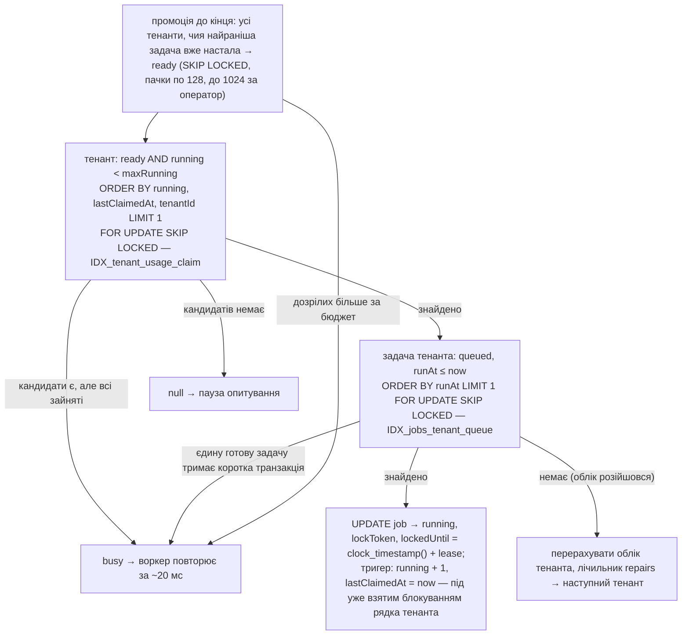

# FlowForge: архітектурні рішення в деталях

Повні записи рішень, межі гарантій і плани запитів. Короткі записи — у [README](../README.md#архітектурні-рішення).

## Архітектурні рішення

### Фундамент

**Схема БД: міграції замість `synchronize`.**
Варіанти: `synchronize: true` (як у стартовому коді); `migrationsRun` при старті кожного
процесу; окремий крок міграцій перед стартом. Обрано окремий крок (`migrate` у compose, CLI
TypeORM): `synchronize` може мовчки видалити колонку з даними при зміні сутності, а кілька
інстансів, що стартують одночасно, змагаються за зміну схеми; `migrationsRun` у кожному
процесі має ту саму гонку. Відповідність міграцій сутностям перевіряє інтеграційний тест
(«no drift»), відкат — тест revert/re-apply. Обмеження: нову міграцію треба вручну додати в
`migrations/index.ts`. Міграції, що перетворюють наявні дані (`StepCheckpoints`, `WorkflowVersions`),
перевіряє `migration-data.int-spec.ts`: БД відкочується до стану перед міграцією, заповнюється даними
в старому форматі, міграція застосовується знову. Міграції виконуються до старту воркерів; оновлення
«на ходу», коли старі воркери ще працюють зі старою схемою, не підтримується.

**Конфігурація.** `@nestjs/config` з валідацією через наявний `class-validator` (підхід із
документації Nest), без окремої бібліотеки схем. Одна схема для API і воркера — вони
запускаються з одного образу й одного `.env`.

**Інтеграційні тести на реальному Postgres.** Варіанти: Testcontainers, pg-mem, реальний
Postgres із compose/CI. Обрано реальний Postgres (`services: postgres` у CI, контейнер із
compose локально): семантика черги (`SKIP LOCKED`, блокування, RLS) має сенс лише на
справжньому Postgres, pg-mem її не підтримує, а Testcontainers додає залежність від Docker
у тестовому процесі без виграшу для CI.

**Кореляція й логування.** `nestjs-pino` (pino-http) + власний `AsyncLocalStorage` (вбудований
у Node): один механізм для HTTP-запитів, задач воркера й cron. Альтернатива — `nestjs-cls`:
зайва залежність для однієї властивості контексту. Воркер отримав службовий HTTP-порт, щоб
мати ті самі `/health`, `/ready`, `/metrics`, що й API.

**Метрики не на публічному порту.** Порт API опублікований назовні, а метрики розкривають
внутрішній стан (а з доменними метриками — і тенантів). Варіанти: токен для збирача на тому самому
порту; прив'язка до `127.0.0.1`; окремий службовий порт. Обрано службовий порт `METRICS_PORT`
(як `WORKER_HTTP_PORT` у воркера): compose його не публікує, секрет для збирача не потрібен, а
публічний порт метрик не віддає взагалі (404). Токен лишив би `/metrics` досяжним ззовні й додав
секрет для ротації; `127.0.0.1` недосяжний для збирача з іншого контейнера. Реалізація — вбудований
`node:http` у процесі API зі спільним реєстром `MetricsService`, без другого Nest-застосунку.
`/health` і `/ready` лишаються на `PORT`: від них залежать healthcheck-и compose, і вони віддають
лише `up`/`down`. Обмеження: службовий порт захищає мережева межа, а не автентифікація — у
середовищі, де внутрішня мережа не довірена, знадобиться ще й автентифікація збирача.

### 3.3.1 Надійна черга

**Механізм черги (ТЗ, розд. 2).** Варіанти: `FOR UPDATE SKIP LOCKED`, lease у рядку задачі,
advisory-локи Postgres. Обрано `SKIP LOCKED` для захоплення + lease (`lockedUntil`) з
fencing-токеном (`lockToken`) для володіння задачею. Advisory-локи прив'язані до сесії
з'єднання: вони звільняються, лише коли рветься саме це з'єднання, а воркер не тримає з'єднання
під час HTTP-кроку (до 15 с) і бере їх із пулу на кожну транзакцію. Довелося б або тримати
окреме з'єднання на кожну задачу (ліміт з'єднань Postgres ділиться на всі воркери), або
лишитися без автоматичного звільнення. Lease у рядку видно в БД (хто тримає, до коли), він
переживає перепідключення, а повернення задачі — звичайний `UPDATE`.

- **Захоплення** — один `UPDATE … WHERE id = (SELECT … ORDER BY "runAt" LIMIT 1 FOR UPDATE SKIP
  LOCKED) RETURNING *`. Кожне захоплення видає новий `lockToken`.
- **Lease і heartbeat.** `JOB_LEASE_MS` (30 с); `LeaseKeeper` продовжує lease кожну третину.
  Локальний строк дії та перше продовження відраховуються від моменту надсилання SQL захоплення за монотонним годинником.
  Кожне наступне продовження призначене на третину lease від старту попереднього успішного, а не
  від його відповіді: запас дедлайну (20% lease) з'їдає затримка одного продовження, а не двох
  поспіль, тож повільна БД (продовження — транзакція з контекстом тенанта) не змушує воркер кинути
  задачу з чинним lease.
  Якщо продовження змінило 0 рядків, lease забрали: `AbortSignal` скасовує поточний крок, і
  воркер більше нічого не пише. Тимчасова помилка БД не скасовує роботу одразу: спроби тривають,
  поки за годинником воркера лишається понад 20% lease.
- **Повернення задач** — один активний reaper на воркер (пауза `lease/2` після завершення проходу, `SKIP LOCKED`, пачками по
  100). Прострочений lease рахується як спроба і повертає задачу з тим самим backoff: «отруйна»
  задача, що раз у раз валить воркер, закінчиться в `dead`, а не крутитиметься вічно.
- **Fencing.** Кожен запис про задачу (чекпоінт, завершення, провал, повернення) — транзакція, що
  починається з `SELECT … FOR UPDATE` рядка задачі з умовою `lockToken = $мій`. Воркер, якого
  вважали мертвим, але який прокинувся, нічого не перезапише.
- **Повтори.** Помилки повторювані: мережа і таймаут, HTTP 408/425/429/5xx, будь-яка не
  класифікована помилка (наприклад, збій БД). Неповторювані: решта 4xx, помилки `transform`. Затримка — full
  jitter у межах `[JOB_BACKOFF_BASE_MS, min(JOB_BACKOFF_MAX_MS, base·2^спроба)]`.
- **Ліміт спроб і `dead`.** `JOB_MAX_ATTEMPTS` (5) на кожен крок: лічильник починається знову
  після кожного чекпоінта. Між кроками він дорівнює нулю. Нове захоплення або початок наступного кроку в тому самому lease зараховує першу спробу. Стани задачі: `queued`,
  `running`, `done`, `failed` (неповторювана помилка), `dead` (повторювані помилки вичерпали
  ліміт або lease минув на останній спробі до фіксації всіх кроків). Виконання в обох останніх випадках — `failed` з
  причиною.
- **Graceful shutdown**: `beforeApplicationShutdown` → не брати нових → чекати до
  `WORKER_SHUTDOWN_GRACE_MS` → скасувати й повернути решту без зарахованої спроби.
- **Час** — завжди годинник БД (`now()`): `runAt`, `lockedUntil`, `wakeAt`, backoff. Розбіжність
  годинників воркерів на чергу не впливає.
- **`Retry-After`**: для 429 і 503 затримка повтору — не менша за запитану
  отримувачем, але в межах `[backoff, JOB_BACKOFF_MAX_MS]`.
- **Неповторювані помилки запиту**: невалідний після підстановки URL,
  заборонений порт, запит, який `fetch` відмовляється надсилати — одразу `failed`.
- **Збій БД під час захоплення**: спільний для циклів воркера експоненційний відступ
  1..30 с, один цикл перевіряє відновлення, один рядок логу на перевірку.
- **Пул з'єднань**: `DB_POOL_SIZE ≥ WORKER_CONCURRENCY + 4`, перевіряється під час
  старту.
- **Дедлайн lease**: окремий таймер скасовує крок, коли до кінця відомого lease
  лишилось 20%, навіть якщо запит продовження ще не повернувся. Reaper повертає всі прострочені
  задачі за прохід, пачками по 100.
- **Повтор виконання** (`POST /executions/:id/retry`). Варіанти: лише стан `dead` для розбору в БД
  (вимога ТЗ уже виконана); новий запуск того самого workflow (втрачає результати завершених кроків
  і повторює їхні ефекти); продовження того самого виконання. Обрано останнє: одна транзакція з
  блокуванням рядка виконання — задача знову `queued` з новим бюджетом спроб (або нова, якщо стару
  вже видалило очищення), виконання — `running`/`pending`. Завершені кроки не повторюються, повторений
  `http` має той самий `Idempotency-Key`. Лише своє виконання тенанта (запит з `tenantId`) і лише `failed`. Обмеження: повтор не застосовує нову версію workflow — виконання
  лишається на своєму знімку.
- **Очищення історії виконань** (`EXECUTION_RETENTION_DAYS`, за замовчуванням вимкнене). Варіанти:
  зберігати завжди; видаляти разом із задачами за тим самим терміном; окремий термін. Обрано окремий
  налаштовуваний термін, вимкнений за замовчуванням: історію тенанта, яку показує API, без рішення
  оператора не видаляємо. Увімкнене — те саме очищення воркера пачками по 500: кроки, задачі й
  виконання одним оператором (`PURGE_EXECUTIONS_SQL`), лише завершені виконання. Разом із виконанням
  зникає і його `Idempotency-Key`.
- **Очищення завершених задач**. Варіанти: видаляти разом із виконаннями (втрата
  історії тенанта), партиціювання за часом, `pg_cron`, періодичне видалення пачками у воркерах.
  Обрано останнє: `jobs.finishedAt`, частковий індекс, пачки по 1000 з `SKIP LOCKED`,
  `JOB_RETENTION_DAYS` (30). Обмеження: видалення пачками — це dead tuples для autovacuum; на дуже
  великих обсягах краще партиціювання. Історію виконань (`executions`, `step_runs`) ці пачки не
  видаляють: її термін задає окремий `EXECUTION_RETENTION_DAYS` (попередній пункт).

Обмеження: опитування (`WORKER_POLL_INTERVAL_MS` з jitter) замість `LISTEN/NOTIFY` дає
паузу до `1,5 × WORKER_POLL_INTERVAL_MS` у порожній черзі. До фактичної затримки захоплення
додаються планування циклу й час запиту до БД (`flowforge_job_claim_latency_seconds`). Reaper
бачить прострочений lease під час наступного проходу. Час відновлення включає роботу БД і backoff. Справедливість між тенантами в запиті захоплення — розділ 3.3.5.

### 3.3.2 Durable execution

Варіанти: перезапуск workflow з нуля (стартовий код), чекпоінт кожного кроку в окремому рядку,
весь контекст одним документом, журнал подій. Обрано рядок на крок (`step_runs`, унікальний
`(executionId, stepIndex)`): результат кроку записується разом із перевіркою lease, повтор
продовжує з першого кроку без `succeeded`, а `ctx.steps` відновлюється з `output` завершених кроків.
Видно історію кожного кроку (`attempts`, `error`, `startedAt`/`finishedAt`).

- **Ключ ідемпотентності.** `step_runs.idempotencyKey` (UUID) створюється разом із рядком кроку
  при першій спробі й не змінюється. Усі спроби цього кроку, також після падіння воркера,
  надсилають той самий заголовок `Idempotency-Key`. Тенант власного `Idempotency-Key` задати не
  може. Ключ не залежить від номера спроби: інакше отримувач не відрізнив би повтор від нового
  запиту. Унікальний індекс дає пошук кроку за ключем.
- **Знімок версії.** `workflow_versions` + `executions.workflowVersionId`:
  виконання працює з кроками, зафіксованими під час створення; правки й видалення workflow його
  не зачіпають. Виконання без знімку воркер не запускає (неповторюваний провал): кроки воркер читає
  лише зі з'єднання за `executions."workflowVersionId"`, і без знімку жодної версії не отримує.
  `CHECK` у БД такого стану не допускає — це остання лінія захисту (`test/unit/version-snapshot.spec.ts`).
- **Ключ запуску.** `Idempotency-Key` на `POST /workflows/:id/run` — рівно одне
  виконання на ключ у тенанті.

Якщо воркер втратив підтвердження COMMIT, він під блокуванням задачі читає стан кроку.
Збережений `succeeded` повертає задачу в чергу для продовження навіть на останній спробі.
Якщо воркер зник після останнього checkpoint, reaper завершує виконання за знімком версії,
використовуючи вихід останнього кроку прямо зі збереженого JSONB.
До фіксації результату `transform` може обчислитися повторно: профіль виразів не має викликів
функцій, а вхід (input і чекпоінти попередніх кроків) збережено, тож повтор дає те саме значення.
Запис `log` може з’явитися двічі. Ефективно-одноразовий ефект `http` гарантується лише для
отримувача, що враховує `Idempotency-Key`; без цього успішний крок дає щонайменше один запит, а
провалений міг не надіслати жодного (див. [README, «Модель гарантій виконання»](../README.md#модель-гарантій-виконання)).

#### Межі транзакцій кроку

Кожен перехід кроку — коротка транзакція тенанта без зовнішнього I/O, і всередині неї — один
оператор SQL з CTE (`START_STEP_SQL`, `CHECKPOINT_SQL` у `checkpoint.service.ts`), як
`FINISH_EXECUTION_SQL` для завершення:

| Перехід | Що змінюється разом | Звернень до БД |
|---|---|---:|
| відновлення після захоплення (`resume`) | читання: виконання, знімок версії, сумарний розмір результатів; потім чекпоінти | 5 |
| початок спроби кроку (`startStep`) | lease задачі, лічильник спроб, рядок кроку, статус виконання `running` | 4 |
| чекпоінт (`checkpoint`, `wakeIfDue`) | lease задачі, результат кроку, лічильник спроб | 4 |

Звернення рахуються разом із `START TRANSACTION`, контекстом тенанта й `COMMIT`. Перший підзапит
`held` блокує задачу (`FOR UPDATE`) і перевіряє fencing-токен; кожна наступна зміна залежить від
попередньої через `EXISTS`, тож порядок блокувань той самий (задача → крок → виконання, див.
«Порядок блокувань» у 3.3.5), а lease, що вже не наш, дає порожній результат і жодних змін. Точну
кількість звернень і поведінку після втрати lease перевіряє `test/integration/step-statements.int-spec.ts`,
вартість під навантаженням — `bench:claim -- steps` (docs/operations.md, «Бенчмарк кроків»).
Рідкісні переходи (провал спроби, паркування `delay`) лишаються кількома операторами в одній
транзакції: вони розгалужуються за станом, прочитаним під блокуванням задачі.

### 3.3.3 Довговічні таймери

Варіанти: `setTimeout` у воркері (стартовий код), окрема таблиця таймерів із власним процесом,
сама черга як таймер. Обрано чергу: крок `delay` в одній транзакції записує
`step_runs.wakeAt = now() + ms` і повертає задачу в `queued` з `runAt = wakeAt`, звільняючи lease
і не зараховуючи спробу. Задачу візьме будь-який воркер, коли настане `runAt`. Якщо її взяли
раніше (повернули вручну чи reaper-ом), вона паркується знову до того самого `wakeAt`, а не
відраховує паузу заново. Слот воркера під час паузи вільний, перезапуск будь-якого компонента
таймер не скидає.

Обмеження: точність пробудження — інтервал опитування черги (за замовчуванням до 0,75 с) плюс
черга перед задачею. Під час паузи виконання має статус `running` (окремого `waiting` немає).
Межа паузи — 30 діб.

### 3.3.4 Ізоляція тенантів у глибину

**Два незалежні шари.** (1) Код: кожен запит сервісу має явний предикат `"tenantId"` (виконання,
кроки, задачі, workflow, версії), а чуже — 404, як неіснуюче. (2) Postgres: RLS з `FORCE` на кожній
тенантній таблиці під ролями без BYPASSRLS. Шари доводяться окремо: `tenant-predicates.int-spec.ts`
запускає сервіси на з'єднанні власника, що обходить RLS (прибраний предикат — червоний тест, хоча
HTTP-тести зелені завдяки RLS), а `rls.int-spec.ts` — прямий SQL під runtime-ролями
в обхід сервісів. Третій рубіж — композитні FK: рядок задачі чи кроку може посилатися лише на
виконання свого тенанта, виконання — лише на знімок свого тенанта (FK-перевірки Postgres не залежать
від RLS, тож це тримається навіть для власника схеми).

**Варіанти.** Схема чи окрема БД на тенанта: міграції й пули з'єднань множаться на кількість тенантів,
черга задач (одна таблиця, спільна для воркерів) розпадається. Лише фільтри в коді (стартовий стан):
одна помилка в запиті — витік. Окрема роль Postgres на кожного тенанта (`SET ROLE`):
ролі множаться, а застосунок, що перемикає роль, однаково може перемкнутися на будь-яку. Обрано RLS з
однією політикою за контекстом `app.tenant_id` (підхід документації Postgres, «Row Security
Policies») поверх предикатів у коді.

**Ролі.** Міграція створює групові ролі (NOLOGIN, спільні для кластера, `down` їх не видаляє):
`flowforge_api_role` і `flowforge_worker_role` — без BYPASSRLS, з правами лише на потрібні операції;
`flowforge_system` — BYPASSRLS, власник SECURITY DEFINER-функцій. Login-ролі `flowforge_api` і
`flowforge_worker` створює `db:provision` (крок `migrate`) з паролями з `.env`, кожна — член лише своєї
групи. Provisioning видає `CONNECT` на цільову БД й відкликає його у `PUBLIC` саме там. Доступ до інших БД кластера визначають їхні власні ACL. Окремі ролі API і воркера —
найменші привілеї: API не може захоплювати задачі чи чистити історію, воркер — читати тенантів,
workflow чи автентифікувати ключі. Міграції виконує суперкористувач: створення ролі з BYPASSRLS і
backfill під `FORCE ROW LEVEL SECURITY` (під яким звичайний власник таблиці теж не бачить рядків)
вимагають саме його.

**Контекст тенанта.** Варіанти: сесійний `SET` під час видачі з'єднання з пулу (лишається на
з'єднанні після повернення в пул — витік до наступного запиту); interceptor, що відкриває транзакцію
на весь HTTP-запит (неявно, тримає з'єднання впродовж усього обробника); явна транзакція з
транзакційно-локальним значенням. Обрано останнє: `TenantDb.run(tenantId, em => …)` — транзакція,
перший оператор якої `set_config('app.tenant_id', $1, true)` (рівнозначно `SET LOCAL`): значення
скидається на COMMIT/ROLLBACK, тож з'єднання з пулу контексту не несе (`tenant-context-pool.int-spec.ts`:
пул на одне з'єднання, після COMMIT, ROLLBACK, помилки й `statement_timeout`). Політика порівнює
колонку з `app_current_tenant()`: UUID із `current_setting('app.tenant_id', true)` або NULL — без
контексту, з порожнім (скинутим) чи сміттєвим значенням не видно нічого й немає помилки приведення.
Транзакція не може змінити тенанта, а невалідний id відхиляється ще до звернення до БД. Правило:
усередині транзакції немає зовнішнього I/O (кроки виконуються поза транзакціями);
`idle_in_transaction_session_timeout` страхує. ESLint (`no-restricted-imports`) забороняє
`@nestjs/typeorm` і `DataSource` поза `src/tenancy` і `src/database`, тож новий код не може обійти
шар випадково (основний захист однаково — fail-closed RLS).

**Крос-тенантні кроки.** Варіанти: BYPASSRLS для ролі воркера (вимикає захист для всього воркера,
включно з виконанням кроків тенантів); виняток у політиці для службової ролі (умова в кожній політиці,
легко помилитися); вузькі SECURITY DEFINER-функції. Обрано функції з фіксованими операціями. Наприклад,
планувальник отримує ідентифікатори тенантів із належними розкладами, а їхні workflow читає під RLS.
Захоплення задач і подій, погашення тикета та порційне очищення змінюють рядки всередині функції. Власник — `flowforge_system`; `SET search_path = pg_catalog, public,
pg_temp` (`pg_temp` явно останнім — інакше він шукається першим, документація Postgres «Writing
SECURITY DEFINER Functions Safely»), усі імена в тілі кваліфіковані; `EXECUTE` — лише потрібній ролі,
`PUBLIC` — нічого; аргументи обмежені. Підміну імен тимчасовою таблицею перевіряє `rls.int-spec.ts`.

| Функція | Роль | Що віддає |
|---|---|---|
| `auth_tenant(api_key_hash)` | API | id тенанта за sha256 ключа та його ефективні ліміти (без секретів) |
| `webhook_tenant(workflow_id)` | API | тенант workflow — адресата webhook-а, увімкненого чи ні (підпис перевіряється в контексті тенанта; вимкнений приймає лише повтор прийнятої доставки) |
| `due_schedule_tenants(after, limit)` | API | тенанти, у яких настав час спрацювання ввімкненого розкладу |
| `auth_session(hash)` | API | ідентифікатори чинної сесії й тенанта, час завершення сесії та ефективні ліміти тенанта |
| `redeem_realtime_ticket(hash)` | API | погашає одноразовий тикет і повертає контекст підписки |
| `renew_realtime_watches(instance, executions, tenants, ttl_ms)` | API | кількість відновлених підписок інстансу; продовжує їх, видаляє рядки інстансу поза переліком і порцію прострочених (лише наявні виконання названого тенанта, до 4 096 за виклик) |
| `purge_browser_credentials(batch)` | API | кількість видалених прострочених сесій і тикетів |
| `lock_tenant_usage()` | API | блокує рядок черги тенанта з контексту до кінця транзакції, потім читає окремий лічильник outbox і повертає числа для допуску роботи |
| `tenant_limits()` | API | ефективні ліміти тенанта з контексту (перевизначення або значення за замовчуванням) |
| `rate_limit_hit(key, window_ms, cost)`, `purge_rate_limits(batch)` | API | лічильник фіксованого вікна ліміту частоти (годинник БД) і кількість видалених відер |
| `claim_job(worker, lease_ms)` | воркер | одна захоплена задача (рядок задачі змінює сама функція з явним предикатом тенанта, 3.3.5), або ознаки «кандидати зайняті» й «облік перераховано» |
| `expired_lease_tenants(exclude, limit)` | воркер | тенанти з простроченими lease (reaper обробляє кожного під RLS) |
| `purge_finished_jobs(days, batch)`, `purge_execution_history(days, batch)` | воркер | кількість видалених рядків, що вже підпадають під термін зберігання |
| `purge_workflow_versions(integer)` | воркер | кількість видалених версій і ознаку швидкого продовження обходу; аргумент — найменша пауза між обходами, мс. Службовий курсор і момент завершення обходу `workflow_version_cleanup` доступні лише системній ролі (S U) |
| `queue_depth_by_tenant()` | воркер | `(tenantId, queued, running)` тенантів із незавершеними задачами (метрика) |
| `claim_outbox_event(sender, lease_ms, in_flight)` | воркер | захоплена подія з тенантом, токеном оренди й номером спроби або результат перерахунку |
| `finish_outbox_event(event_id, token, delay_seconds, result, http_status)` | воркер | чи вдалося за чинним токеном завершити доставку або призначити повтор |
| `purge_delivered_events(days, batch)` | воркер | кількість видалених доставлених і скасованих подій за строком зберігання |
| `outbox_backlog()` | воркер | кількість подій у станах `pending` і `sending` та час створення найстарішої з них за тенантом |

**Автентифікація запиту.** `auth_tenant` і `auth_session` повертають разом з ідентифікаторами
ефективні ліміти тенанта тим самим виразом, що й `tenant_limits()`. Guard автентифікації робить
один виклик замість пошуку ключа й окремої транзакції тенанта (BEGIN, контекст, читання тенанта,
`tenant_limits()`, COMMIT): до обробника запит доходить після двох звернень до БД — автентифікації та
`rate_limit_hit`, а не семи. Кешу немає: відкликаний ключ, завершена сесія чи змінений ліміт діють з
наступного запиту на кожному інстансі. Обидві функції повертають лише `uuid`, `integer` і строк
сесії — секрети (хеші ключа й токена, секрет webhook-а) у результат не потрапляють (`rls.int-spec.ts`).
Кількість звернень і рівність лімітів із `tenant_limits()` перевіряє `auth-statements.int-spec.ts`.
Варіанти: кеш тенанта й лімітів у пам'яті інстансу (відкликаний ключ діяв би до TTL на інших
інстансах — відхилено); злиття й `rate_limit_hit` (зв'язує guard автентифікації з throttler-ом —
відхилено).

API, воркер і системна роль також можуть викликати `app_current_tenant()`, яку використовує політика RLS.
Тригерні функції викликаються тригерами. API й воркер не мають гранту `EXECUTE` на них.

**Операції → права.** Ролі в таблиці — `flowforge_api_role`, `flowforge_worker_role` та `flowforge_system`.
S, I, U, D означають `SELECT`, `INSERT`, `UPDATE`, `DELETE`. Політика порівнює вказану колонку з
`app_current_tenant()` для читання й запису. `db-acl.int-spec.ts` звіряє права з каталогом PostgreSQL,
а `role-operations.int-spec.ts` перевіряє операції під runtime-ролями.

| Таблиця | Колонка політики RLS | API | Воркер | Системна роль |
|---|---|---|---|---|
| `workflow_version_cleanup` | — | — | — | S U |
| `workflow_usage` | `tenantId` | — | — | S I U |
| `browser_sessions` | `tenantId` | S I D | — | S U D |
| `realtime_tickets` | `tenantId` | S I D | — | S U D |
| `realtime_watches` | `tenantId` | S I U D | — | S I U D |
| `tenants` | `id` | S I U | — | S I U D |
| `webhook_deliveries` | `tenantId` | S I | — | — |
| `workflows` | `tenantId` | S I U D | — | S I U D |
| `workflow_versions` | `tenantId` | S I | S | S I U D |
| `executions` | `tenantId` | S I U | S U | S I U D |
| `step_runs` | `tenantId` | S | S I U | S I U D |
| `jobs` | `tenantId` | S I U | S U | S I U D |
| `notification_settings` | `tenantId` | S I U D | S | S I U D |
| `outbox_events` | `tenantId` | S U | S U | S I U D |
| `outbox_attempts` | `tenantId` | S | S U | S I U D |
| `tenant_usage` | `tenantId` | — | — | S I U D |
| `tenant_outbox_usage` | `tenantId` | — | — | S I U D |
| `limit_defaults` | — | — | — | S I U D |
| `rate_limit_buckets` | — | — | — | S I U D |
| `migrations` | — | — | — | — |

`TRUNCATE` (обходить RLS), `REFERENCES`, `TRIGGER`, DDL, таблиця `migrations` — нікому з runtime-ролей;
`CREATE` у схемі `public` відкликано в `PUBLIC`.

**Перевірка на старті.** API і воркер не стартують, якщо їхня роль — суперкористувач, має BYPASSRLS,
може діяти як роль із такими атрибутами, `flowforge_system` чи власник таблиць; якщо API ходить роллю
воркера чи навпаки; якщо будь-яка доступна ролі таблиця схеми `public` не має RLS + FORCE + політики
(нова таблиця, додана без політики, зупинить старт); якщо група процесу має право `EXECUTE` на
функцію схеми `public` поза своїм рядком таблиці функцій вище (прямий грант групі чи `PUBLIC`, напр.
`claim_job` для API — він забирав би задачі, або тригерна функція обліку) чи на SECURITY DEFINER-функцію
в будь-якій іншій несистемній схемі, до якої має `USAGE`; якщо в оточенні є облікові дані власника
(`MIGRATION_DATABASE_URL`). Окрім цього, процес звіряє весь каталог з інваріантами безпеки (нижче, «Інваріанти безпеки»), тож чужий грант будь-якій ролі чи зайва політика теж зупиняють старт. Вимкнути перевірку не можна (`db-security-check.int-spec.ts`).
Сесія мусить бути автентифікована саме runtime-роллю: `session_user` і роль, з якою увійшов backend
(`pg_stat_activity`), збігаються з `current_user`. Інакше власник із startup-опцією `role=…` пройшов
би перевірку як runtime-роль, а `RESET ROLE` повернув би йому права суперкористувача.

**Хто може діяти службовою роллю.** Ролі спільні для кластера, тож перевіряється не лише роль процесу,
а й чужі члени службових ролей. Член групи процесу сам виставляє будь-який `app.tenant_id`, а член
`flowforge_system` обходить RLS. Тому:

- у `flowforge_system` членів немає взагалі;
- член `flowforge_api_role` чи `flowforge_worker_role` — лише login без атрибутів і ADMIN OPTION, що
  не входить в інші ролі й сам не має членів (такі ролі створює `db:provision`). Права цих логінів в
  інших БД кластера не враховуються: тести й compose законно живуть на одному кластері.

Перевіряють це три точки: `TenantIsolation` перед тим, як дати `flowforge_system` BYPASSRLS (і ще вимагає,
щоб `flowforge_system` не володіла жодним об'єктом цієї БД: заздалегідь створений view чи функція з її
власником читали б усіх тенантів навіть після виходу автора з членства); `db:provision` до будь-якої
зміни; старт API й воркера (пізніший `GRANT` зупиняє процес). Міграція вимагає PostgreSQL 16+: модель
спирається на його правила членств (на PG16 творець ролі з CREATEROLE отримує на неї ADMIN OPTION, і
перевірка це бачить; до PG16 CREATEROLE дозволяв призначити собі будь-яку роль). Варіанти: маркер
`COMMENT ON ROLE` підробив би той самий, хто заздалегідь створив роль; відмова за самим фактом
наявності ролі ламала б повторні прогони міграцій на спільному кластері.

**BYPASSRLS діє на весь кластер.** Це атрибут ролі, а не БД, тож перше надання `flowforge_system`
відкрило б обхід RLS і в інших БД кластера: definer-функція чи view цієї ролі, створені там заздалегідь,
почали б читати рядки поза політикою. Тому, поки роль ще без BYPASSRLS, міграція вимагає, щоб вона не
володіла нічим у жодній БД кластера (і спільними об'єктами), і називає БД, де знайдено об'єкти
(`system-role-bypass.int-spec.ts`: пастка з RLS-таблицею й definer-функцією в сусідній БД). Якщо роль
уже має BYPASSRLS (її налаштувала міграція іншої БД того самого кластера, напр. тестової поруч із
compose), надання нічого в кластері не змінює, а об'єкти тієї БД законні. Альтернатива — окрема
системна роль на кожну БД (`flowforge_system_<db>`): ізоляція повніша, але ім'я ролі перестає бути
сталою, а від неї залежать міграції, матриця прав, перевірки на старті й compose; перевірка першого
надання закриває той самий сценарій без цієї ціни.

**Чий логін змінює `db:provision`.** Наявний логін вважається своїм, лише якщо він уже прямий член своєї
групи: `CREATE ROLE` і `GRANT` виконуються в одній транзакції, тож роль від `db:provision` без членства
не буває. Логін з тим самим ім'ям, що належить комусь іншому, лишається з паролем і без прав застосунку;
помилка радить видалити роль або обрати інше ім'я (`API_DB_USER`, `WORKER_DB_USER`). Якщо членство
зняли вручну, його відновлюють `GRANT flowforge_api_role TO <логін>` (або `flowforge_worker_role`).

**Межа гарантії.** Контекст тенанта ставить сам runtime-процес після автентифікації: API — за ключем
або підписом webhook-а, воркер — за `tenantId` захопленої задачі. RLS захищає від помилок коду (забутий
предикат, неправильний id), а не від скомпрометованого процесу чи SQL-ін'єкції: та сама роль може
задати будь-яке `app.tenant_id`. Від цього захищає параметризація всіх запитів і найменші права ролі
(зокрема, API не може захоплювати задачі, а воркер — читати секрети тенантів). Між тенантами навмисно
віддають дані лише функції з таблиці вище й лише те, що в ній перелічено.


#### Модель загроз і непідтримуваний стан

**Від кого захищаємо.** Тенант (будь-які запити з власним ключем, визначення workflow, вхід
виконань, частота й обсяг запитів); відправник webhook-а (будь-хто в інтернеті); ціль кроку `http`
і endpoint сповіщень (відповідь, редиректи, DNS, розмір, швидкість); користувач фронтенду. Жоден із
них не повинен читати чи змінювати дані іншого тенанта, виконати код хоста, дістатися внутрішньої
мережі, обійти ліміти чи вичерпати ресурси воркерів для інших. Система переживає падіння будь-якого
процесу в будь-якій точці, кілька інстансів, рестарт і недоступність Postgres, повтори й дублікати,
часові пояси й DST.

**Кому довіряємо.** Оператору розгортання: суперкористувачу Postgres, що запускає міграції,
власнику хоста й compose, тому, хто має доступ до `.env`.

**Підтримуване розгортання.** PostgreSQL 16+, Node.js за `engines` з `apps/api/package.json`. Ролі
`flowforge_api_role`, `flowforge_worker_role`, `flowforge_system`, login-ролі `db:provision` і
об'єкти схеми `public` створюють і змінюють лише міграції й `db:provision`. Кластер може бути
спільним з іншими БД FlowForge (тестова поруч із compose).

**Непідтримуваний стан виявляється, а не захищається.** Ролі, гранти, `ALTER DEFAULT PRIVILEGES`,
політики RLS, сесії чи об'єкти, які створив не FlowForge (заздалегідь, паралельно або вручну
всупереч інструкції), система не намагається «обробити безпечно» сценарій за сценарієм. Вона
відмовляється працювати: інваріанти безпеки нижче звіряють фактичний каталог із дозволеним
переліком, міграції відкочуються, а API й воркер не стартують.

#### Інваріанти безпеки

`src/tenancy/security-posture.ts` (`findPostureViolations`) звіряє каталог Postgres із переліком
`POSTURE` — кінцевим станом після всіх міграцій. Перевірка рольово-агностична: одержувачем може
бути будь-яка роль, включно з `PUBLIC` і ролями, про які FlowForge нічого не знає.

| Інваріант | Що звіряється |
|---|---|
| I-1 Службові ролі | Точні атрибути (`NOLOGIN`, без SUPERUSER/CREATEDB/CREATEROLE/REPLICATION, BYPASSRLS лише в `flowforge_system`), жодних налаштувань ролі, **жодної сесії** під службовою роллю в усьому кластері, жодних сторонніх членів; службові ролі не володіють і не мають прав ні на що в цій БД поза таблицями й функціями `public` (view чи definer-функція системної ролі в іншій схемі читали б усіх тенантів) |
| I-2 Точні права | Для кожної функції, таблиці, view і послідовності `public`: власник і повний набір (одержувач, право), крім прав самого власника, точно за переліком. Без грантів із `GRANT OPTION`, без прав на окремі стовпці, без `CREATE` у `public` для будь-кого, крім власника. Невідомий об'єкт допустимий, лише якщо він належить власнику міграцій і нікому нічого не дає |
| I-3 Точні політики | На кожній таблиці з указаною колонкою політики в матриці «Операції → права» — RLS + FORCE і рівно одна політика `tenant_isolation` (PERMISSIVE, усі команди, `PUBLIC`, точний вираз). Інші політики будь-де в `public` — порушення: дозвільні політики Postgres об'єднує через `OR`, тож одна чужа відкрила б рядки всім |

**Де перевіряється.** (1) `npm run db:migrate` (`src/database/migrate.ts`, крок `migrate` у compose)
виконує всі невиконані міграції й звірку в **одній транзакції** під advisory-локом (на лок іншого запуску чекає не довше 10 хв, далі відмовляє з поясненням, а не висить): якщо
каталог не відповідає переліку, транзакція відкочується й жодне надання (зокрема BYPASSRLS системній
ролі) не набуває чинності. Звірка виконується й без нових міграцій, тож кожен запуск виявляє дрейф;
два одночасні запуски виконуються по черзі. (2) Старт API й воркера (`DatabaseSecurityCheck`): дрейф
після розгортання зупиняє процес. Процеси, що вже працюють, побачать дрейф лише після рестарту: зміну
каталогу між рестартами може зробити тільки довірений оператор. Інтеграційні тести будують схему тим
самим `migrate()`.

**Наявна службова роль не «лагодиться».** `TenantIsolation` відмовляє, якщо наявна службова роль має
інші атрибути (зокрема LOGIN) або сесії, замість `ALTER ROLE … NOLOGIN`: до COMMIT такої зміни роль
ще пускала б нові сесії, і вони отримали б BYPASSRLS. Єдина зміна наявної ролі — BYPASSRLS для
`flowforge_system` (для ролі, що вже має його від іншої БД кластера, вона нічого не змінює).

**Нова таблиця чи функція.** Міграція, що додає об'єкт у `public`, має додати й запис у `POSTURE`
(права, власник, політика). Без нього `db:migrate` відкотиться з повідомленням, що називає об'єкт.
Повідомлення містять лише імена об'єктів і ролей (до 20), без даних тенантів.

**Варіанти.** Окремі перевірки в кожній міграції під кожен сценарій (так було раніше: кожен новий
сценарій «у кластері вже є чужий X» потребував нової латки). Окрема перевірка після `migration:run`
(після COMMIT уже пізно: сесія, відкрита під роллю з LOGIN, отримала б BYPASSRLS). Звірка в
транзакції міграцій і на старті закриває весь клас одним механізмом. Для чужої політики
розглядалась і RESTRICTIVE-політика-страж: вона захищає лише від оператора, що додасть політику між
рестартами, і додає ще одну поверхню, тож обрано точний набір політик.

#### Ліміти тенанта

**Контракт лімітів.** Значення за замовчуванням — `TENANT_*` (записує `db:provision` у
`limit_defaults`), перевизначення окремого тенанта — адмін-API (`limits` у `POST /tenants`,
`GET`/`PATCH /tenants/:id/limits`, `null` — значення за замовчуванням). Межі перевіряються і в API
(400), і `CHECK`-обмеженнями в БД.

| Ліміт (env за замовчуванням) | Межі | Одиниця | Перевизначення | Діє на |
|---|---|---|---|---|
| одночасні задачі (`TENANT_MAX_RUNNING`, 10) | 1..1000 | задач у стані `running` | `maxConcurrentExecutions` | нові **захоплення** |
| розмір черги (`TENANT_MAX_QUEUE_SIZE`, 100 000) | 1..10 000 000 | незавершених задач: `queued` + `running`, включно з паузами `delay` | `maxQueueSize` | нові **постановки**: run, webhook, cron, `/retry` |
| кількість workflow (`TENANT_MAX_WORKFLOWS`, 1000) | 1..100 000 | збережених workflow тенанта (лічильник `workflow_usage` у транзакції вставки й видалення) | `maxWorkflows` | нові **створення** `POST /workflows`: на межі — 429 `workflow_limit_reached` без `Retry-After`, місце звільняє видалення |
| квота outbox (`TENANT_MAX_OUTBOX_EVENTS`, 200 000) | 1..10 000 000 | недоставлених подій (`pending` + `sending`) разом із незавершеними задачами | `maxOutboxEvents` | нові **постановки** й redeliver; прийняті події не видаляються |
| частота API (`TENANT_RATE_LIMIT` / `…_WINDOW_MS`, 600 / 60 с) | 1..1 000 000 / 1..3600 с | запитів тенанта за вікно, усі маршрути разом | `rateLimit` | запити з `x-api-key` |
| частота webhook-ів (`TENANT_WEBHOOK_RATE_LIMIT` / `…_WINDOW_MS`, 600 / 60 с) | ті самі | webhook-ів тенанта за вікно — окрема квота | `webhookRateLimit` | webhook-и з чинним підписом |
| адмін-ендпоінти (`ADMIN_RATE_LIMIT` / `…_WINDOW_MS`, 30 / 60 с) | 1..10 000 / 1..3600 с | запитів з однієї IP-адреси | — | кожен запит `/tenants…`, ще до перевірки токена |
| невдалі автентифікації (`AUTH_FAILURE_RATE_LIMIT` / `…_WINDOW_MS`, 30 / 60 с) | ті самі | невдач з однієї IP-адреси | — | невірний ключ або підпис, webhook невідомому workflow: понад ліміт — 429 замість 401/404; успішні запити не рахуються |

«Одночасне виконання» — задача в стані `running`: пауза `delay` слоту не тримає (3.3.3), тож
виконання на паузі обмежує ліміт черги, а не ліміт одночасних задач. Зниження ліміту нижче поточного
використання нічого не перериває: задачі в роботі завершуються, черга лишається, а новим захопленням
і постановкам діє новий ліміт. Задачі з простроченим lease рахуються в `running`, доки їх не поверне
reaper.

**Облік.** `tenant_usage` — рядок на тенанта: `queued`, `running`, найраніший `runAt` у черзі
(`nextRunAt`), готовність, момент останнього захоплення, ефективні ліміти. Його веде SECURITY
DEFINER-тригер на `jobs` у тій самій транзакції, що й зміна задачі, тож у кожному закоміченому стані
лічильники **точно** дорівнюють агрегатам `jobs` (`queue-consistency.int-spec.ts` звіряє їх одним
оператором — одним знімком — кожні 25 мс під змішаним навантаженням). Варіанти: `count(*)` на кожну
постановку (O(розміру черги) і гонка без блокування), лічильники в коді сервісів (легко пропустити
шлях — reaper, очищення, повтор), тригер. Ліміти за замовчуванням — у БД, а не в env кожного процесу:
API і воркер не можуть розійтися.

Після захоплення чи вилучення найранішої задачі тригер шукає новий `nextRunAt` як
`ORDER BY "runAt" LIMIT 1` за `IDX_jobs_tenant_queue`, а не `min("runAt")`. Коли статистика ще не
бачить свіжого backlog-у тенанта, планувальник оцінює його чергу в один рядок і для `min()` обирав
агрегат по всіх задачах тенанта: одне захоплення з черги в 20 000 задач читало 20 001 рядок
(`tenant-usage-next-run.int-spec.ts`). `LIMIT` зупиняє обхід на першому живому записі за будь-якої
оцінки. Межа: записи індексу для вже захоплених задач пропускаються, доки Postgres не позначить їх
мертвими, а для цього жодна відкрита транзакція не повинна їх бачити. Довга транзакція в кластері
(аналітика, зависле з'єднання) знову робить пошук пропорційним кількості захоплень за час її життя,
доки її не завершать і не мине vacuum таблиці `jobs`.

**Ліміт черги.** Постановка (`ExecutionsService`) блокує рядок обліку тенанта
(`lock_tenant_usage`) і лише під блокуванням шукає `Idempotency-Key`: повтор уже прийнятого запиту
повертає його виконання (200), навіть коли черга тим часом заповнилась, а десять однакових
паралельних запитів на останнє місце дають один 201 і дев'ять 200 з тим самим виконанням. Повна
черга — 429 `queue_full` ще до будь-якої вставки (нічого не створено). `Retry-After` немає: коли
звільниться місце, залежить від завершення задач і невідомо. `/retry`: виконання `FOR UPDATE` →
облік → задача; при повній черзі — 429, виконання й чекпоінти без змін. Cron при повній черзі
відкладає спрацювання: курсор стоїть, `scheduleBlockedSince` і `flowforge_enqueue_rejected_total{trigger="cron"}`, після звільнення місця момент створюється (3.3.8).

**Частота запитів.** `@nestjs/throttler` (документація Nest, «Rate Limiting») зі сховищем у Postgres:
власне `ThrottlerStorage`, фіксоване вікно, атомарний upsert функцією `rate_limit_hit` за годинником
БД — один лічильник на всі інстанси API. Guard розширює `ThrottlerGuard`:
- ключ — `<ліміт>:<тенант або IP>` без імені обробника: одна квота на всі маршрути тенанта;
- заголовки `X-RateLimit-Limit`, `X-RateLimit-Remaining` і `X-RateLimit-Reset` без суфікса імені на
  кожній відповіді, що пройшла через ліміт, а на перевищенні — ще й `Retry-After` і тіло
  `rate_limited`;
- guard-и рівня контролера, тож `/health`, `/ready` і `/metrics` не обмежені.

Webhook-и рахуються лише після чинного підпису й на тенанта адресата: підпис перевіряє guard
(`WebhookSignatureGuard`, порівняння за сталий час), а не обробник. Недоступна БД — 5xx, а не
мовчазний пропуск ліміту. Варіанти: лічильник у пам'яті (кожен інстанс рахував би окремо), Redis
(заборонений), пряма таблиця під RLS (runtime-ролі могли б скидати свої лічильники). `UNLOGGED`
для відер відкинуто: таблиця обнулялася б після падіння сервера й не реплікується; `fillfactor 70`
лишає місце для HOT-оновлень лічильників. Відра, чиє вікно скінчилось, API видаляє пачками щохвилини.

**IP клієнта.** Ліміти за IP беруть `req.ip`: без `TRUST_PROXY` — адресу з'єднання (заголовок
`X-Forwarded-For` ігнорується, інакше клієнт сам вибирав би собі IP). За реверс-проксі —
`TRUST_PROXY` з кількістю переходів або адресами проксі (Express `trust proxy`). IPv6 групується за
підмережею /64, як у throttler-а. Ланцюжок адрес браузера та заголовки 429 описані в [README, «Межа довіри браузера»](../README.md#межа-довіри-браузера).


### 3.3.5 Справедливе планування

**Вимога.** Тенант, що поставив у чергу десятки тисяч задач, не повинен суттєво збільшувати затримку
задач інших тенантів.

**Порядок обслуговування.** Серед тенантів, у яких є готова задача (`nextRunAt ≤ now`) і які не
досягли ліміту одночасних задач, наступним обслуговується той, у кого **найменше задач у роботі**, а
серед рівних — **найдавніше обслужений** (`lastClaimedAt`), далі за `tenantId`; у нього береться
найраніша готова задача. Тенанти, що вже працюють, ділять слоти за max-min, а тенант без задач у
роботі ніколи не чекає за чужою глибиною черги. Новий тенант отримує `lastClaimedAt = момент
створення` і стає в кінець черговості, а не перескакує тих, хто вже чекає.

**Захоплення** — одна SECURITY DEFINER-функція `claim_job`, один оператор; стандартна для черг на
Postgres схема `FOR UPDATE SKIP LOCKED` (документація Postgres, «The Locking Clause»), застосована
двічі:



- **Жорсткий ліміт одночасних задач.** Рядок тенанта блокується в тому самому операторі; Postgres
  перевіряє умову `running < maxRunning` на найновішій версії заблокованого рядка (EvalPlanQual), а
  `running` збільшує тригер під цим блокуванням. Два захоплення одного тенанта не можуть разом
  перевищити ліміт (`tenant-concurrency.int-spec.ts`: 50 паралельних циклів при ліміті 3 → рівно 3).
- **Без черги блокувань.** Рядок, який тримає інша транзакція, пропускається: паралельні цикли
  всіх воркерів розходяться по різних тенантах, а не чекають на рядок одного, і завершення задач
  тенанта не стоять за захопленнями.
- **Готовність без сканування.** Частковий індекс `IDX_tenant_usage_claim` має той самий предикат і
  порядок, що й вибір, тож це Index Scan без Sort, O(log T) — насичені тенанти й тенанти лише з
  майбутніми задачами в нього не потрапляють. «Настала задача» залежить від часу й не може бути
  предикатом індексу: прапорець `ready` ставить тригер (коли задача вже готова) і промоція на
  початку кожного захоплення (коли час минув), за індексом `IDX_tenant_usage_maturing`.
- **Промоція до кінця, перш ніж обирати.** Захоплення просуває всіх тенантів, чия задача настала до
  початку оператора, а вже потім обирає. Перша версія просувала одну пачку (32) за захоплення:
  тенант B за 64 іншими дозрілими тенантами потрапляв до вибору лише на третьому захопленні, і
  швидкий тенант A без задач у роботі тим часом обслуговувався двічі — без жодної конкуренції.
  Тривалість одного оператора обмежена бюджетом (8 пачок по 128): якщо дозрілих більше, захоплення
  нікого не обирає й повертає busy, а промоцію продовжують наступні (паралельні — різні рядки, SKIP
  LOCKED). Так сплеск зі 100 000 тенантів, що дозріли в одну мить, не впирається в `statement_timeout`
  і не відкочується без прогресу, а порядок вибору однаково враховує всіх дозрілих.
- **Зайнята задача — busy.** Якщо SKIP LOCKED пропустив готову задачу тенанта (її рядок тримає коротка
  транзакція), захоплення повертає busy, а не «черга порожня»: воркер повторює за мить, а не через повний
  інтервал опитування. Облік при цьому не перераховується — він правильний.
- **Lease** починається з самого захоплення (`clock_timestamp()`), а локальний відлік воркера — до
  надсилання оператора, тобто не пізніше за БД.

**Гарантія.** Поки тенант B має готову задачу, жодної в роботі й не досяг ліміту, кожен інший тенант
захоплюється не більше одного разу (після захоплення його ключ гірший за ключ B), плюс захоплення,
чий вибір почався раніше (не більше за кількість паралельних циклів C), плюс ті, що відбулися,
поки рядок B тримала його ж коротка транзакція (постановка чи завершення його задачі — мілісекунди).
Тобто від глибини черг інших тенантів затримка B не залежить. `fair-claim.int-spec.ts` перевіряє це за журналом захоплень (4 паралельні цикли, 8 тенантів, ≤ (K−1)+C
захоплень інших за будь-яке очікування), а також: один слот і тенант із 2000 задач — строге чергування;
B за 64 дозрілими тенантами з задачами в роботі — A не більше одного разу раніше за B; дозрілих більше за
бюджет промоції — busy без вибору, далі найкращий за ключем; зайнята єдина задача — busy;
50 тенантів — кожен раз, перш ніж будь-хто двічі; 150 тенантів, що дозріли одночасно (більше за пачку
промоції), — кожен раз; затримка, що настала, поки рядок тенанта зайнятий, — обслуговується першим
же захопленням після звільнення; насичені й лише з майбутніми задачами тенанти не заважають; новий
тенант — у кінці черговості; кілька воркерів — B завершується, поки в A понад 90% backlog-у.

**Варіанти, що розглядались.**
- FIFO (стартовий стан).
- Найменше в роботі, далі найстаріша задача — на одному слоті тенант із давнішими задачами
  обслуговується весь час.
- Глобальна серіалізація рішень (одне захоплення за раз, advisory lock) — стеля пропускної
  здатності для всіх тенантів.
- WFQ/DRR із вагами — ваг ТЗ не вимагає, а стан дефіциту треба вести для кожного тенанта.
- **Очікування рядка найкращого кандидата** з перевіркою свіжості під блокуванням (перша
  реалізація в цьому PR) — строгіша межа, але паралельні цикли обирали того самого тенанта й
  ставали в чергу на його рядок. Виміряно 160–950 захоплень/с і p95 39–180 мс (FIFO на тій самій
  машині — ~2500/с, 8 мс), а за повільної БД завершення задач тенанта чекали за чергою захоплень,
  доки не минали lease-и. Розподіл кандидатів між циклами (у процесі, потім advisory lock-ами) дав
  лише 880–950/с.
- Обрано стандартний `SKIP LOCKED` на рівні тенантів, а потім задач. Ціна — обхід тенанта лише на
  мілісекунди його власних транзакцій.

**Порядок блокувань.** Правило: у кожній транзакції воркера оновлення `jobs`, яке через тригер
зачіпає рядок обліку тенанта, — останній оператор; захоплення не чекає ніколи.

| Операція | Порядок |
|---|---|
| завершення, провал, пауза, повернення в чергу, чекпоінт, reaper | задача (`FOR UPDATE`) → виконання → облік (тригер) |
| захоплення | облік (SKIP LOCKED) → задача (SKIP LOCKED) — без очікування |
| постановка (run, webhook, cron) | облік (`lock_tenant_usage`) → нові рядки |
| `/retry` | виконання → облік → задача (термінальна — її не тримає ні воркер, ні reaper) |
| очищення | лише термінальні рядки, облік не змінюється |

Ребра «тримає → чекає»: задача → виконання, виконання → облік, облік → термінальна задача (лише
`/retry`). Ребра облік → облік немає, захоплення не чекає — циклу немає. Перевіряє
`queue-consistency.int-spec.ts`: два воркери, постановка через API, повтори, reaper проти воркерів
(lease відбирається посеред кроку), очищення, примусові ROLLBACK і транзакції, що тримають рядки
обліку. Жодного deadlock-у, кожен знімок обліку точно дорівнює агрегатам `jobs`, `running` ніде не
перевищує ліміт.

**Вимірювання** — «Chaos- і навантажувальні сценарії»: бенчмарк захоплення й навантажувальний
сценарій «шумного сусіда».

### 3.3.6 Безпечне виконання кроків

**Вихідний HTTP.** Спільний транспорт перевіряє HTTP(S)-URL, IP-літерал, усі A/AAAA і кожен redirect. IPv4-mapped адреси проходять IPv4-перевірку. Дозволено публічний unicast, із виключеннями для локальних інтерфейсів, службових адрес та операторських CIDR. Якщо внутрішня мережа має публічно маршрутизований префікс, оператор вносить його в `HTTP_DENY_CIDRS`. Кожен перехід отримує окремий dispatcher. Перевірені адреси передаються в lookup сокета, Host/SNI та стандартна перевірка TLS лишаються прив’язаними до імені з URL. Окрема DNS-перевірка перед звичайним fetch допускала б повторне визначення адреси. Egress proxy потребував би окремого сервісу. [Connector undici 6.29.1](https://github.com/nodejs/undici/blob/v6.29.1/lib/core/connect.js)

| Межа | Поведінка |
|---|---|
| Час усієї операції | `HTTP_STEP_TIMEOUT_MS` — 15 000 мс, дозволено 1–60 000. Бюджет спільний для DNS, TLS, усіх переходів і читання. Втрата lease теж скасовує транспорт. |
| Відповідь | `HTTP_RESPONSE_BYTES` — 1 048 576 байтів, дозволено 1–1 048 576. Ліміт фактичного потоку діє без Content-Length. До 16 КіБ заголовків. Запитується identity, інші Content-Encoding відхиляються. Текстовий результат зберігається цілим. Для JSON перевіряється, що жодне число не зміниться до збереження. Неточне число дає неповторювану помилку кроку. |
| Перенаправлення | До 5 переходів. HTTPS→HTTP відхиляється. На інший origin дозволений GET/HEAD без тіла та користувацьких заголовків. Метод POST на 301/302 і відповідний 303 переходять у GET. Стабільний ключ належить початковому ефекту, `x-request-id` задає платформа. |
| Причина відмови | Політика адрес, розмір та невалідний запит дають остаточну помилку. Мережевий збій, timeout і 408/425/429/5xx допускають повтор. Для 429/503 підтримується Retry-After. Отримувач побічного ефекту має зберігати Idempotency-Key. |

**Шаблони.** URL, HTTP-тіло та повідомлення log читають лише власні властивості `input` і `steps`. При відсутньому полі підстановка порожня. Межі перевіряються під час побудови рядка. URL — до 2 048 символів, тіло — 32 КіБ, лог — 4 096 символів.

**Transform.** Наприклад, `{"id":"shape","type":"transform","expr":"{\"total\": input.quantity * 2}"}` створює версійований крок JSONata. Підтримуються шляхи від `input` і `steps`, літерали, арифметика, порівняння, логіка, умова та конструктори масивів/об’єктів зі сталими ключами. У довільних функцій, шаблонів регулярних виразів і динамічної компіляції немає форми у дозволеному профілі. Перевірка AST відбувається і при записі, і при виконанні. Простий старий шлях `ctx.steps.call.status` читається за власними властивостями зі старою семантикою масивів. Шлях без значення в обох мовах дає `null`; у конструкторі об’єкта такий ключ пропускається. Помилка обчислення допустимого виразу над конкретними даними (наприклад, `input.name + 1` для рядка або старий шлях через відсутнє проміжне поле) дає остаточну помилку `transform: expression evaluation failed`. Вираз поза профілем чи межами ресурсів дає `transform: expression or result exceeds the supported profile`.

Кожне обчислення працює в окремому процесі Node з порожнім оточенням і V8 old-space 32 МіБ. Повернення кроку після скасування чекає на закриття процесу. Межі — 4 096 символів виразу, 256 вузлів, 32 рівні AST, 4 МіБ контексту, 8 МіБ сумарної верхньої оцінки для посилань на контекст (кожен шлях оцінюється розміром JSON значення за його найглибшим власним префіксом, а на масиві — усього масиву, бо шлях JSONata розходиться по елементах; дешеві скалярні посилання поруч із великим значенням не вичерпують межу), 64 КіБ серіалізованого результату і 2 048 рівнів JSON. JSONata отримує timeout 250 мс, stack 128 та sequence 4 096. Зовнішній deadline 2 с включає запуск та завершення каналу. Пам’ять heap, розмір JSON і RSS є різними вимірами. Воркер зберігає старий чекпоінт і завершує неприйнятний крок без автоматичного повтору. Межа таймера в event loop самого воркера не забезпечила б його доступності, а worker thread ділить з ним процес. [JSONata guardrails](https://docs.jsonata.org/guardrails) · [JSONata 2.2.2](https://github.com/jsonata-js/jsonata/blob/v2.2.2/jsonata.d.ts) · [Node 20 child processes](https://nodejs.org/download/release/v20.20.2/docs/api/child_process.html)

### 3.3.7 Вхідні webhook-и

Відправник надсилає UTF-8 JSON на `POST /hooks/:workflowId`. Кожен із трьох заголовків трапляється рівно раз.

| Заголовок | Формат |
|---|---|
| X-Webhook-Timestamp | Цілі десяткові секунди Unix без знака й провідних нулів. Час PostgreSQL має відрізнятися не більш як на 300 секунд у будь-який бік включно. |
| X-Webhook-Delivery-Id | 1–128 ASCII літер, цифр, крапок, дефісів або підкреслень. Відправник зберігає цей ID і байти тіла при кожному повторі. |
| X-Signature | `v1=` і 64 малі hex-цифри HMAC-SHA256. Ключ — байти UTF-8 виданого рядка секрету. |

Префікс — ASCII `v1\n<workflowId>\n<timestamp>\n<deliveryId>\n`. Кожне `\n` позначає один байт LF. UUID записується малими літерами. Після останнього LF йдуть точні байти HTTP-тіла. HMAC обох ключових позицій порівнюється через timingSafeEqual. Raw parser маршруту обмежує накопичення до `HTTP_BODY_LIMIT`, стиснення заборонено. Після автентифікації перевіряються окрема квота webhook, UTF-8, JSON і семантичний ліміт входу 64 КіБ. Підписаний нуль байтів дає порожній об’єкт; JSON-літерал `null` відхиляється з 400. [Парсер сирого тіла Express](https://github.com/expressjs/body-parser/blob/1.20.4/lib/types/raw.js)

Вставте `WEBHOOK_SECRET` через сховище секретів або локальне оточення. Задайте `WEBHOOK_URL` як повний URL маршруту. Команди запускаються з `apps/api`. Обидві доставки друкують 202 та той самий UUID. Якщо тіло відповіді 202 не вдалося прочитати, скрипт завершується з кодом 1 і повідомленням `delivery accepted (HTTP 202), but …` з причиною. Доставку прийнято, і повтор тих самих байтів із тим самим ID поверне той самий executionId. Відповідь API без `executionPurged` друкує лише ID.

```bash
npm ci
npm run chaos:sink:build
printf '%s\n' '{ "name": "Ada" }' > event.json
node dist/scripts/send-webhook.js "$WEBHOOK_URL" order-42 event.json
node dist/scripts/send-webhook.js "$WEBHOOK_URL" order-42 event.json
```

Область унікальності — тенант, workflow та delivery ID. Ті самі байти дають 202 з попереднім executionId, інші байти — 409. Відповідь 202 — `{ executionId, executionPurged }`: `executionPurged: true` означає, що історію виконання вже очищено, повтор прийнято без нового виконання, а GET за цим ID поверне 404. Після втрати відповіді повторіть оригінальні байти з тим самим ID. Можна оновити час і підпис. 401 означає помилку автентифікації або часу, 400 — невалідний підписаний вхід, 413 — транспортний ліміт, 415 — непідтримуване кодування чи тип. Невідомий workflow дає 404. Вимкнений workflow нових доставок не приймає (404 після перевірки підпису, до розбору тіла й без блокування обліку тенанта; це автентифікований запит, тож він рахується квотою webhook тенанта, а не лімітом невдалих автентифікацій), але підписаний повтор уже прийнятої доставки отримує 202 з її executionId: квитанція живе, доки існує workflow. Для 429 застосовується чинний контракт rate_limited/queue_full. Відхилення до commit лишає доставку доступною для повтору.

**Транзакційна межа.** Guard встановлює тенанта й ID ключа. Після ліміту частоти обробник відкриває транзакцію з tenant context, блокує тенанта і workflow для читання, рядок обліку для постановки, повторно звіряє активність ключа та час. Далі читає квитанцію, перевіряє квоту нової події і разом фіксує версію, execution, job та квитанцію. Квитанція містить digest тіла й executionId. Первинний індекс `webhook_deliveries_pkey` перевіряється через EXPLAIN у тесті оновлення. Видалення історії виконань зберігає квитанцію; повтор після очищення читає квитанцію разом із виконанням (`LEFT JOIN` за ID і тенантом) і повідомляє `executionPurged: true` замість ID, що виглядав би живим. Видалення workflow каскадно очищає квитанції. Ціна тривалої дедуплікації — рядок на доставку живого workflow. TTL дозволив би прийняти пізній перепідписаний повтор. Хеш тіла як єдиний ідентифікатор змішав би дві різні події. [Блокування PostgreSQL 16](https://www.postgresql.org/docs/16/explicit-locking.html)

**Ротація без простою.** Запити власника мають `x-api-key`. GET `/tenants/me/webhook-secrets` повертає `[{id, role}]`: `current` — ключ, що діяв до ротації, `next` — створений нею. POST /tenants повертає і `webhookKeyId` початкового ключа. POST на той самий маршрут повертає 201 та `{id,secret}` один раз, з Cache-Control no-store. Початковий секрет отримує оператор при POST /tenants. Збережіть нове значення, переведіть відправників і викличте DELETE `/tenants/me/webhook-secrets/:keyId` для попереднього ID. Обидва ключі діють під час переходу. Третій ключ і видалення останнього дають 409, повторне видалення вже відсутнього — 204. Після втрати відповіді POST відкличте ключ із роллю `next` (його секрет ніхто не отримав) і повторіть ротацію. Зміна ключів блокує рядок тенанта `FOR NO KEY UPDATE`: вона серіалізується з повторною перевіркою ключа webhook-постановки (`FOR SHARE`), але не затримує вставки виконань і задач тенанта, яким потрібне лише `FOR KEY SHARE` зовнішнього ключа. Старий секрет після відкликання відхиляється також на прогрітих інстансах.

**Оновлення з попередньої версії.** Підготуйте відправників до v1, призупиніть вхідний трафік і збережіть події на стороні відправника. Звірте старі доставки з невизначеним результатом. Завершіть запити та gracefully зупиніть API, планувальник і воркери. Створіть перевірену резервну копію. З нової збірки, з `MIGRATION_DATABASE_URL` власника, запустіть `npm run webhook:preflight`. Звіт друкує ID workflow чи execution, індекс кроку та стан чекпоінту. Перевірте виділені визначення зі старим JS та історію з великими результатами. Опублікуйте потрібні нові версії. Знімок розпочатого виконання лишається старим. Несумісний ще не виконаний вираз дасть остаточну помилку, а новий запуск вимагає звірки попередніх ефектів. Виконайте `db:migrate` і `db:provision` за інструкцією розгортання, перевірте readiness кожного нового процесу і тестову v1-доставку, потім відновіть приймання. Міграція зберігає байти чинного секрету. Не допускайте стару версію API до live-трафіку після перемикання. Після появи квитанцій або другої активної позиції downgrade відмовляє для збереження даних.

### 3.3.8 Планувальник

**Джерело істини — курсор у рядку workflow.** `workflows."scheduleCursor"`: усі моменти розкладу
до цього моменту включно оброблено (створено, вже існували або відкинуто політикою). Курсор
ставиться в `now()` під час створення workflow, зміни `cron` чи `timezone`, ввімкнення і в міграції
наявних рядків; зміна лише `missedRunPolicy` курсор не чіпає. `nextFireAt` — підказка «не пізніше за
наступний момент» із частковим індексом `IDX_workflows_due`: тік читає лише належні розклади
(`due_schedule_tenants`), а не всі.

**Одне спрацювання — одна коротка транзакція** в контексті тенанта (`SchedulerService.fireIn`):

1. `SELECT … FROM workflows … FOR NO KEY UPDATE SKIP LOCKED` — рядок, який уже обробляє інший
   інстанс, пропускається (а не чекає); `now` — `clock_timestamp()` БД, спільний для всіх інстансів.
2. Наступний момент після курсора — з генератора (нижче). Ще не настав — лише підказка `nextFireAt`.
3. Момент, строго старший за `SCHEDULER_MISFIRE_GRACE_MS` (60 с), — пропущений, далі політика;
   момент рівно на межі вчасний (`decideMissed`). `run_once` запускає останній
   пропущений момент і ставить на нього курсор. `skip` відкидає пропущені й у тій самій транзакції
   за тим самим `now` запускає перший вчасний момент — тоді курсор стає саме ним; лише якщо
   вчасний момент ще не настав, курсор лишається на останньому пропущеному. Так курсор ніколи не
   проходить повз вчасний момент. Попередження
   `missed scheduled runs skipped…` має поля `firstSkipped` і `lastSkipped` (обидва включно);
   у попередній версії друге поле звалося `skippedUntil` і містило межу допуску.
4. `lock_tenant_usage` → наявне виконання з тим самим `(tenantId, workflowId, scheduledAt)` →
   ліміт черги → виконання й задача (`ExecutionsService.enqueueScheduledIn`) → новий курсор.
5. COMMIT. Курсор і виконання з'являються разом або ніяк.

Ідентичність спрацювання — `(tenantId, workflowId, scheduledAt)` з генератора, а не час процесу;
кореляційний ID — `cron:<workflowId>:<scheduledAt, мс>`, однаковий для кожної спроби того самого
моменту. Порядок блокувань: workflow → облік тенанта → задача; з webhook-ом (тенант → workflow →
облік), запуском, редагуванням і видаленням циклу немає (`scheduler-locks.int-spec.ts`).

| Збій | Стан після відновлення | Доказ |
|---|---|---|
| два інстанси на тому самому моменті | одне виконання; другий пропускає зайнятий рядок | `scheduler-instances` (бар'єр через `pg_sleep` у тригері) |
| з'єднання обірвано посеред проходу | k закомічених спрацювань, курсор на k-му, решта — наступним тіком, без дубля | `scheduler-instances` (`pg_terminate_backend` на 4-й вставці) |
| COMMIT відбувся, клієнт не дізнався | повтор бачить курсор або наявне виконання: `existing`, без дубля | `scheduler-instances` |
| рестарт | моменти простою — за політикою | `scheduler-progress`, `scheduler-missed` |
| SIGTERM посеред тіку | поточне спрацювання дописується до закриття пулу, решту бере наступний процес | `scheduler-instances` |
| повна черга | курсор стоїть, `scheduleBlockedSince`, метрика; після звільнення — вчасне створюється, старе — за політикою | `tenant-queue-limit` |
| невалідний розклад у БД (успадкований) | `scheduleError`, `nextFireAt = NULL`, інші розклади й тенанти працюють; PATCH з виправленням — відновлення | `scheduler-missed` |
| очищення історії видалило виконання | повтору немає: прогрес — у курсорі, а не в історії | `scheduler-missed` |

**Політики пропущених запусків** (`missedRunPolicy`, за замовчуванням `run_once`). Простій із 10:00
до 10:47, розклад `*/15 * * * *` (UTC), межа 60 с, процес піднявся о 10:47:30:

| Політика | Створено | Курсор після |
|---|---|---|
| `skip` | нічого за 10:00…10:45 (+1 до `flowforge_schedule_firings_total{outcome="missed_skipped"}`) | 10:45 (останній пропущений), далі 11:00 |
| `run_once` | одне виконання з `scheduledAt = 10:45` — останній пропущений момент | 10:45 |
| `run_all` | 10:00, 10:15, 10:30, 10:45 — кожен зі своїм `scheduledAt` | 10:45 |

`run_all` нічого не відкидає. Прохід тенанта обмежений бюджетом раунду (16 спроб), далі хід
переходить до наступного тенанта; залишок не тримається в пам'яті, а продовжується з курсора в
наступних раундах і тіках, тож тенант із тижневим пропуском секундного розкладу не відсуває інших
(`scheduled-fairness`: малий тенант обслужено в перших раундах, усі 600 моментів сусіда — по разу).
Межу кількості виконань дає ліміт черги тенанта: повна черга відкладає наздоганяння, а не обрізає
його. Простій БД, повна черга й пропуск після рестарту — одна й та сама ситуація для політики.

**Часові пояси й DST.** Зона — ім'я IANA (`Intl` його знає; зміщення на кшталт `+03:00`, `local`,
`system` — 400), аліаси приймаються (`US/Eastern`, `Europe/Kiev`). Проба `cron-parser@4.9.0` (Node
20.19, ICU 77.1, tzdata 2025b) показала, що його `next()` з `tz` залежить від точки старту:
`*/20 3 * * *` у `Europe/Kyiv` 2026-03-29 безперервно дає `01:00, 01:20, 01:40Z`, а з перезапуском
з кожного моменту — лише `01:00Z`; `30 3 * * *` з `2026-10-25T01:10Z` повертає `01:30Z` (вдруге того
дня), з `00:45Z` — 10-26; `prev()` має іншу семантику переходів, ніж `next()`. Тому генератор
`CronSchedule` (`src/scheduler/cron-schedule.ts`) перебирає **наївний** місцевий час через
`cron-parser` у режимі UTC (там немає переходів) і відображає його в реальні моменти за правилом
RFC 5545 §3.3.5:

- час, якого немає (весняний розрив), — зі зміщенням до розриву, тобто на розмір розриву пізніше;
- час, що повторюється (осіння година), — перше проходження; для розкладів, де поле годин охоплює
  всі 24 (`*/30 * * * *`), — обидва, щоб реальний інтервал не мав «дірки»;
- однакові UTC-моменти зливаються в один.

| Розклад | Зона | Перехід | Моменти (UTC) |
|---|---|---|---|
| `30 3 * * *` | Europe/Kyiv | 2026-03-29 03:00→04:00 | 03-28T01:30, **03-29T01:30** (04:30 EEST), 03-30T00:30 |
| `30 3 * * *` | Europe/Kyiv | 2026-10-25 04:00→03:00 | **10-25T00:30** (лише перше), 10-26T01:30 |
| `*/20 3 * * *` | Europe/Kyiv | весна | 03-29T01:00, 01:20, 01:40; 03-30T00:00 |
| `*/30 * * * *` | Europe/Kyiv | осінь | 00:30, 01:00, 01:30, 02:00 (обидва проходження) |
| `30 2 * * *` | America/New_York | 2026-03-08 | **03-08T07:30** (03:30 EDT), 03-09T06:30 |
| `30 1 * * *` | America/New_York | 2026-11-01 | **11-01T05:30** (лише перше), 11-02T06:30 |

Таблицю зашито в `cron-schedule.spec.ts` очікуваннями, визначеними за правилами зон, а не тією самою
бібліотекою. Окремо тест порівнює генератор із незалежним еталоном (перебір кожної хвилини вікна через
`Intl` за правилом вище, без `cron-parser`) для Kyiv, New York і Lord Howe (перехід на 30 хв),
починаючи з кожної півхвилини ±6 год навколо переходу. Робота на один момент — O(1) викликів
`cron-parser` плюс бінарний пошук переходу; `lastAtOrBefore` для `run_once` — двійковим пошуком за часом: кількість викликів генератора
зростає логарифмічно з довжиною інтервалу в секундах.

**Альтернативи.**

| Рішення | Варіанти | Обрано |
|---|---|---|
| прогрес | `lastTick` у пам'яті (стартовий); похідний з `max(executions.scheduledAt)` (губиться з очищенням історії); окрема таблиця спрацювань (росте без межі); **курсор у рядку workflow** | курсор: переживає рестарт і очищення історії, атомарний із постановкою, O(1) на розклад |
| ексклюзивність | advisory-lock «лідера» (зупиняє все при зависанні лідера, не допомагає при невідомому COMMIT); лише унікальний індекс (не доводить, що перший запис з'явиться, і не пов'язаний із курсором); **блокування рядка workflow + індекс як страховка** | блокування рядка |
| моменти | `cron-parser` з `tz` (залежить від точки старту, проба вище); інша бібліотека (поза погодженим стеком, той самий ризик без доказу); **генератор над `cron-parser` (UTC) + `Intl`** | генератор |
| пропущені моменти | ліміт кількості для `run_all` (мовчки перетворив би «всі» на «перші N»); **межа роботи за прохід + курсор** | без обрізання |

**Обмеження.** Без перешкод вчасний момент обробляє найближчий тік: не пізніше ніж через
`SCHEDULER_TICK_MS` (30 с) після настання; перший тік — через інтервал після старту. Відкладають
спрацювання: рядок, зайнятий іншим інстансом чи редагуванням (`SKIP LOCKED` — наступний тік); повна
черга чи квота outbox (до звільнення місця, `scheduleBlockedSince`); тривалий раунд наздоганяння
(порції по 16 спроб на тенанта); простій процесу чи БД. Момент, що через це став старшим за
`SCHEDULER_MISFIRE_GRACE_MS`, обробляє `missedRunPolicy`, а не відкидає. Межа пропуску не менша за тік. Між інстансами не має значення годинник
процесу: «зараз» — час БД. Секундні розклади дозволені; кількість виконань обмежують ліміти тенанта.

### 3.3.9 Вихідні події

Контракт для отримувача й оператора — у розділі
[«Сповіщення: отримувач і оператор»](operations.md#сповіщення-отримувач-і-оператор).

**Модель.** Виконання (`executions`), логічна подія (`outbox_events`: стабільний `id`, незмінні байти
`payload`, стан доставки) і спроба доставки (`outbox_attempts`: номер, відправник, ревізія endpoint-а,
ключі, результат) — окремі сутності. Одне трасування (`correlationId`) може мати кілька подій
(виконання й кожен його `/retry`); повтор доставки однієї події — той самий `id`, інший
`x-flowforge-attempt`.

**Запис у транзакції завершення.** Тригер `BEFORE UPDATE OF status ON executions` рахує
`terminalCycles` (перехід у `succeeded`/`failed` із некінцевого), `AFTER`-тригер (SECURITY DEFINER,
власник `flowforge_system`), якщо в тенанта є налаштування сповіщень (увімкнені чи на паузі), вставляє подію з
`sequence = terminalCycles` і payload, серіалізованим один раз (`jsonb_build_object(...)::text`).
Тож подія фіксується разом із завершенням на кожному з чотирьох шляхів — завершення воркером
(`FINISH_EXECUTION_SQL`), провал кроку (`checkpoints.fail`), reaper довершив чи провалив задачу
зниклого воркера — і на будь-якому майбутньому. Відкат завершення відкочує й подію; повторна обробка
того самого переходу нової події не дає (номер циклу не росте), `UNIQUE (tenantId, executionId,
sequence)` — страховка. Завершення до міграції подій не створюють (`terminalCycles = 1` для вже
завершених, тож їхній `/retry` дає `sequence 2`).

**Доставка (воркер, `OutboxSender`).**

1. TX захоплення `claim_outbox_event` (SECURITY DEFINER, EXECUTE — лише роль воркера; повертає лише
   ID і токен): тенант з належною подією за `notification_settings."dueAt"` (найдавніше обслужений
   першим, `FOR NO KEY UPDATE SKIP LOCKED`), не більше `OUTBOX_TENANT_IN_FLIGHT` спроб тенанта
   одночасно в кластері; подія з простроченим lease — першою, інакше найраніша належна; новий
   `leaseToken`, `leaseUntil = now + 2 × OUTBOX_HTTP_TIMEOUT_MS + 5 с`, рядок у `outbox_attempts`.
2. TX читання (RLS тенанта): подія за токеном і **чинні** налаштування одним запитом — адресат і ключі
   однієї спроби завжди з одного стану конфігурації; спроба записує ревізію й ID ключів.
3. HTTP поза транзакцією: політика адрес кроків `http` під час з'єднання, без редиректів, таймаут
   `OUTBOX_HTTP_TIMEOUT_MS`, тіло відповіді не читається, тіло запиту — збережені байти.
4. TX результату — лише `WHERE "leaseToken" = <свій> AND status = 'sending'`: 2xx — `delivered`,
   інакше `pending` з `nextAttemptAt = now + backoff` (експоненційний із повним jitter,
   `OUTBOX_BACKOFF_BASE_MS`..`OUTBOX_BACKOFF_MAX_MS`, не раніше за `Retry-After`). Запізніла відповідь
   спроби, чий lease перехопили, нічого не змінює (метрика `outcome="stale"`).

Головний сценарій — отримувач прийняв подію, а підтвердження загубилось або відправник упав до
запису результату: після lease подію захоплює будь-який відправник і доставляє з тим самим `id` і
тими самими байтами. Отримувач бачить щонайменше два запити й дедуплікує за `id` — це і є «щонайменше
один раз». Кількість спроб необмежена, доки тенант явно не відмовиться від події. Мінімальні права
крос-тенантного відправника: захоплення, очищення доставлених і скасованих подій та беклог для метрик — три вузькі definer-функції;
читання налаштувань і запис журналу — під RLS тенанта події. Окрема функція `finish_outbox_event` бере тенанта з поточного контексту, перевіряє lease і знижує `dueAt` до нового строку повтору в тій самій транзакції. Порядок блокувань — налаштування, подія, спроба. Матриця в `db-acl` перевіряє EXECUTE для цієї функції у воркера й власника, відсутність доступу з API та PUBLIC і попередні права решти функцій. Вставки подій у роль
воркера немає (її робить тригер).

Зміна або видалення налаштувань і ручна повторна доставка спочатку блокують рядок тенанта через `FOR NO KEY UPDATE`. Цей рядок існує й без конфігурації сповіщень. Нове налаштування читає час наступної спроби тільки після того, як попередня операція закомітила повернення подій у `pending`.

| Збій | Стан після | Доказ |
|---|---|---|
| завершення відкотилось | події немає; закомічене завершення — одна | `outbox-atomicity` |
| воркер упав після COMMIT завершення | подія `pending`, її бере будь-який відправник | `outbox-atomicity`, e2e |
| підтвердження втрачено / відправник упав після 2xx | повтор із тим самим `id` і байтами, ≥ 2 запити, `delivered` | `outbox-delivery`, e2e, `chaos:notifications` |
| старий відправник завис і відповів пізніше | `delivered` нової спроби не змінено, журнал старої — `lease_expired` | `outbox-delivery` |
| endpoint недоступний | повтори з backoff до стелі без ліміту | `outbox-delivery` (7 спроб при `JOB_MAX_ATTEMPTS = 3`) |
| один endpoint висить | інші тенанти отримують далі, він займає ≤ 2 спроби | `outbox-delivery` |
| DNS змінено на внутрішню адресу, редирект | `denied` / `redirect`, без з'єднання з внутрішньою адресою й без переходу | `outbox-delivery` |
| рестарт Postgres під час доставки | усі події доставлено, одна на завершення | `chaos:notifications` |
| ротація / зміна URL / пауза / видалення з подією в очікуванні | обидва підписи / новий URL / пауза з прийманням нових подій / подія чекає `pending` і доставляється після наступного налаштування; `cancelled` — лише явний `discard` тенанта | `notification-settings`, `outbox-delivery`, `migration-data` |

**Альтернативи.**

| Рішення | Варіанти | Обрано |
|---|---|---|
| запис події | INSERT у кожному з чотирьох шляхів (легко пропустити шлях); сканер завершених виконань (не атомарний, губить цикли `/retry`); **тригер на `executions`** | тригер |
| ексклюзивність спроби | `FOR UPDATE` на час HTTP (транзакція тримається під час мережі); advisory-lock (не переживає обрив з'єднання); **lease + fencing-токен** | lease |
| підпис | фіксований при створенні (ротація ламає перевірку подій, що чекають; немає часу спроби); **на кожну спробу над незмінними байтами** | на кожну спробу |
| конфіг спроби | знімок при створенні (подія йшла б на покинутий домен); **чинний на момент спроби** | чинний (погоджено) |
| зберігання недоставлених | ліміт спроб чи вік із видаленням (суперечить «щонайменше один раз»); лише метрики (сховище без межі, ТЗ 4); **квота тенанта на недоставлені події разом із живими виконаннями: прийняте зберігається, заповнена квота зупиняє нову роботу цього тенанта** | квота (погоджено в PR 7) |
| секрет підпису | **відкрито в колонці під RLS, як секрет вхідних webhook-ів (3.3.7)**; шифрування ключем застосунку (воркеру однаково потрібен ключ, оператор БД довірений) | як у 3.3.7 |
| вибір тенанта | найстаріші події глобально (тенант із великим беклогом займає всі цикли); **рядок налаштувань як черга тенантів + ліміт спроб у роботі** | рядок налаштувань |

**Обмеження.** Порядок подій не гарантується. Подія «тонка»: результат виконання — через API. Поки
endpoint недоступний, події накопичуються до квоти `maxOutboxEvents`, а далі нова робота тенанта
отримує 429 `outbox_full`. Історія спроб зберігає першу й останні 19 спроб кожної події. Підказка `dueAt` може бути застарілою (у
бік «раніше»): захоплення тоді перераховує її (`flowforge_outbox_due_repairs_total`).

### 3.3.10 Спостережуваність

**Кореляційний ID наскрізь.** Запит API (`x-request-id` або згенерований) → `executions` і `jobs`
(`correlationId`) → воркер обробляє задачу в її контексті після будь-якого рестарту чи на іншому
інстансі → крок `http` надсилає `x-request-id` (і після редиректу на той самий origin) → тригер
записує ID трасування, що завершило цикл, у подію → відправник працює в контексті
`event.correlationId` і надсилає `x-request-id`. Для cron вхідного запиту немає: ID —
`cron:<workflowId>:<scheduledAt>`, детермінований для моменту. `/retry` — нове трасування (ID запиту
повтору), лог повтору має `originalCorrelationId`, подія нового циклу — ID повтору. Повтор однієї
події — той самий `x-flowforge-event-id`, інший `x-flowforge-attempt`; інша подія того самого
трасування — інший `id`. Доказ — `scheduler-outbox-e2e.int-spec.ts` (запит і cron, до доставки).

**Метрики** — у розділі [«Спостережуваність»](operations.md#спостережуваність): що міряє кожна, який процес, одиниці
й агрегування між інстансами. Значення перевіряються після відомої послідовності операцій
(`worker-metrics`, `queue-depth-metric`, `outbox-metrics`), а не лише наявність назв.


### 3.3.11 Real-time

Протокол і клієнт описано в README («Протокол WebSocket»). Тут — серверна частина сповіщень.

#### Сповіщення лише для переглянутих виконань

Кожна зміна виконання й кожен запис кроку змінюють `executions.revision`, а тригер
`notify_execution()` надсилає `ff_execution` з `tenant:execution`. Коміт транзакції з `NOTIFY` у
Postgres бере глобальне блокування черги сповіщень, тож сповіщення на кожен крок кожного виконання
серіалізувало б коміти всіх воркерів, хоча більшість виконань ніхто не дивиться. Тому тригер
надсилає сповіщення лише тоді, коли в `realtime_watches` є чинна підписка на це виконання.

- **Підписка.** Шлюз тримає один рядок на (виконання, інстанс API), скільки б сокетів не дивились
  виконання. Перший сокет у контексті тенанта спершу бере `FOR SHARE` на рядок виконання, потім
  вставляє підписку, і лише після коміту шлюз читає знімок. `FOR SHARE` чекає на транзакцію, що вже
  змінює виконання (її тригер підписки ще не бачив), тож її зміну покаже знімок, а всі пізніші
  тригери бачать підписку. Останній сокет видаляє рядок.
- **Строк дії.** Рядок діє 45 с, і кожні 15 с шлюз продовжує всі свої підписки одним викликом
  `renew_realtime_watches`. Той відновлює відсутні рядки (лише для наявних виконань названого
  тенанта), видаляє рядки інстансу поза переліком і порцію прострочених рядків будь-яких інстансів.
  Рядки інстансу, що впав, спливають самі. Якщо рядки довелося відновити (БД була недоступна довше за
  строк дії), шлюз одразу перечитує всі знімки. Під час завершення інстанс прибирає свої рядки.
- **Права.** `notify_execution()` — SECURITY DEFINER із власником `flowforge_system`, тож тригер бачить
  підписки під будь-якою роллю, що змінює виконання. Роль воркера прав на таблицю не має. Підписки під
  RLS тенанта, як і решта тенантних таблиць.

Наслідок: у `bench:claim -- steps` сповіщень на крок 0 замість 2,1, якщо виконання ніхто не дивиться.
Поведінку перевіряє `test/integration/realtime-watches.int-spec.ts`: сповіщення лише за підписки під
роллю воркера й власника, refcount, гонка з транзакцією, що вже змінює виконання, продовження,
межі аргументів, RLS.

Варіанти:
- прибрати `NOTIFY` і опитувати `revision` зі шлюзу — до 256 запитів на секунду на інстанс і затримка
  до інтервалу опитування;
- statement-level тригер — блокування береться на транзакцію, а не на рядок, тож не допомагає;
- таблиця підписок (обрано): сповіщень немає для всіх непереглянутих виконань, включно з очищенням
  історії.

## Індекси і плани запитів

| Запит | Індекс |
|---|---|
| вибір тенанта для захоплення | `IDX_tenant_usage_claim` — `tenant_usage (running, "lastClaimedAt", "tenantId") WHERE ready AND running < "maxRunning"` (частковий, у порядку ключа вибору) |
| промоція дозрілих тенантів | `IDX_tenant_usage_maturing` — `tenant_usage ("nextRunAt") WHERE NOT ready AND "nextRunAt" IS NOT NULL AND running < "maxRunning"` (частковий) |
| найраніша готова задача тенанта (захоплення, облік) | `IDX_jobs_tenant_queue` — `jobs ("tenantId", "runAt") WHERE status = 'queued'` (частковий; замінив `IDX_jobs_claim`) |
| очищення відер ліміту частоти | `IDX_rate_limit_buckets_reset` — `rate_limit_buckets ("resetAt")` |
| пошук прострочених lease (reaper) | `IDX_jobs_lease` — `jobs ("lockedUntil") WHERE status = 'running'` (частковий) |
| належні розклади тіку (`due_schedule_tenants`, сторінка тенанта) | `IDX_workflows_due` — `workflows ("nextFireAt") WHERE enabled AND cron IS NOT NULL AND "nextFireAt" IS NOT NULL` (частковий) |
| наступна подія тенанта для доставки | `IDX_outbox_events_pending` — `outbox_events ("tenantId", "nextAttemptAt") WHERE status = 'pending'` (частковий) |
| спроби з простроченим lease, спроби в роботі | `IDX_outbox_events_sending` — `outbox_events ("tenantId", "leaseUntil") WHERE status = 'sending'` (частковий) |
| очищення доставлених подій | `IDX_outbox_events_delivered` — `outbox_events ("deliveredAt") WHERE status = 'delivered'` (частковий) |
| очищення скасованих подій | `IDX_outbox_events_cancelled` — `outbox_events ("cancelledAt") WHERE status = 'cancelled'` (частковий) |
| журнал подій тенанта (курсор) | `IDX_outbox_events_tenant_created` — `outbox_events ("tenantId", "createdAt", id)` |
| тенанти, яким є що надсилати | `IDX_notification_settings_due` — `notification_settings ("dueAt") WHERE enabled` (частковий) |
| запуск за `Idempotency-Key` тенанта | `UQ_executions_idempotency_key` — унікальний `executions ("tenantId", "idempotencyKey") WHERE "idempotencyKey" IS NOT NULL` (частковий) |
| задача виконання (повтор, очищення історії) | `IDX_jobs_execution` — `jobs ("executionId")` |
| завершені виконання, старші за термін історії | `IDX_executions_finished` — `executions ("finishedAt") WHERE status IN ('succeeded', 'failed')` (частковий) |
| завершені задачі, старші за термін зберігання (очищення) | `IDX_jobs_finished` — `jobs ("finishedAt") WHERE status IN ('done', 'failed', 'dead')` (частковий) |
| пошук кроку за ключем ідемпотентності | `UQ_step_runs_idempotency_key` — унікальний `step_runs ("idempotencyKey")` |
| чекпоінти виконання | `UQ_step_runs_execution_step` — унікальний `step_runs ("executionId", "stepIndex")` |
| версія workflow для виконання | `UQ_workflow_versions_workflow_version` — унікальний `("workflowId", "version")` |
| список виконань тенанта (курсор, без фільтра) | `IDX_execution_page_tenant` — `executions ("tenantId", "createdAt", id)`; замінив `("tenantId", "createdAt")` стартового коду: порядок курсора `"createdAt" DESC, id DESC` береться з індексу без сортування (`query-plans.int-spec.ts`) |
| список виконань за статусом / workflow / обома | `IDX_execution_page_status`, `IDX_execution_page_workflow`, `IDX_execution_page_workflow_status` — ті самі ключі з колонками фільтра перед `"createdAt", id` |
| список workflow тенанта (курсор) | `IDX_workflows_tenant_created` — `workflows ("tenantId", "createdAt" DESC, id DESC)`; `steps` у SELECT немає, тож jsonb визначень не читається (`workflow-list.int-spec.ts`: розмір сторінки однаковий для визначень 200 Б і 60 КіБ) |
| сесії тенанта (межа кількості), прострочені сесії й тикети (очищення) | `IDX_sessions_created`, `IDX_tickets_expiry`, `IDX_expire_browser_sessions`, `IDX_expire_realtime_tickets` |

Часткові індекси містять лише задачі в черзі чи в роботі, а завершені (яких з часом переважна
більшість) не потрапляють в індекс. На 100 тис. задач (99,8% `done`) кожен із них займає 16 КіБ.
Старий індекс `(status, "runAt")` видалено.

**Як перевірено.** Індекси планувальника й outbox — `scheduler-outbox-plans.int-spec.ts` (20 тис. розкладів, з них 20 належних; 50 тис. подій, з них 20 недоставлених і 10 скасованих; 3001 налаштування тенантів, одне належне): кожен перевірений запит (вибір тенанта для доставки, належні розклади, наступна подія тенанта, подія з простроченим lease, очищення доставлених і скасованих подій, сторінка журналу подій) йде своїм індексом без `Seq Scan`. Інтеграційний тест `query-plans.int-spec.ts` засіває 20 тис. задач і кроків
і для того самого SQL, що виконує черга (оператори з тіла `claim_job` у каталозі, `EXPIRED_LEASES_SQL`,
`FINISHED_JOBS_SQL`, `PURGE_FINISHED_SQL`, `PURGE_EXECUTIONS_SQL`, пошук за ключем запуску й
задачі за виконанням), перевіряє в
`EXPLAIN (FORMAT JSON)`, що використовується потрібний індекс і немає `Seq Scan`.

Вибір тенанта перевірено окремо на 2000 тенантах (1000 готових з 0–2 задачами в роботі, 400
насичених з лімітами 1..5, 300 лише з майбутніми задачами, 20 дозрілих, ще не просунутих, решта
порожні): `EXPLAIN (ANALYZE, BUFFERS)` — Index Scan за `IDX_tenant_usage_claim` без Sort, у тесті
межі ≤ 5 мс і ≤ 64 сторінки. Вручну:

```text
-- вибір тенанта (2000 тенантів)
Limit (actual rows=1 loops=1)
  Buffers: shared hit=4
  ->  LockRows (actual rows=1 loops=1)
        ->  Index Scan using "IDX_tenant_usage_claim" on tenant_usage u (actual rows=1 loops=1)
              Filter: (ready AND ("tenantId" <> ALL ('{}'::uuid[])) AND (running < "maxRunning"))
              Buffers: shared hit=3
Execution Time: 0.034 ms
-- усе захоплення (claim_job: промоція 20 тенантів, вибір, задача, тригер обліку)
Function Scan on claim_job (actual rows=1 loops=1)
Execution Time: 2.076 ms
```

Решта — вручну на 100 тис. задач (`EXPLAIN (ANALYZE, COSTS OFF, TIMING OFF)`):

```text
-- reaper
Limit (actual rows=100 loops=1)
  ->  LockRows (actual rows=100 loops=1)
        ->  Index Scan using "IDX_jobs_lease" on jobs (actual rows=100 loops=1)
              Index Cond: ("lockedUntil" < now())
-- ключ ідемпотентності
Index Scan using "UQ_step_runs_idempotency_key" on step_runs (actual rows=0 loops=1)
  Index Cond: ("idempotencyKey" = '…'::uuid)
-- очищення: одна пачка (PURGE_FINISHED_SQL, 100 тис. задач, 99,6% done, термін 30 днів)
Delete on jobs (actual rows=0 loops=1)
  InitPlan 1 (returns $1)
    ->  Limit (actual rows=1000 loops=1)
          ->  LockRows (actual rows=1000 loops=1)
                ->  Index Scan using "IDX_jobs_finished" on jobs jobs_1 (actual rows=1000 loops=1)
                      Index Cond: ("finishedAt" < (now() - '30 days'::interval))
  ->  Bitmap Heap Scan on jobs (actual rows=1000 loops=1)
        Recheck Cond: (id = ANY ($1))
        ->  Bitmap Index Scan on "PK_cf0a6c42b72fcc7f7c237def345" (actual rows=1000 loops=1)
Execution Time: 1.784 ms
-- очищення історії: одна пачка (PURGE_EXECUTIONS_SQL, 20 тис. виконань із кроком і задачею)
Delete on executions e
  CTE batch -> … ->  Bitmap Index Scan on "IDX_executions_finished"
  CTE steps -> Delete on step_runs s -> … Bitmap Index Scan on "UQ_step_runs_execution_step" (actual rows=316)
  CTE queue -> Delete on jobs j -> … Bitmap Index Scan on "IDX_jobs_execution" (actual rows=316)
  ->  Bitmap Index Scan on "PK_703e64e0ef651986191844b7b8b"
Execution Time: 3.647 ms
```

Перша версія видалення кроків і задач (`= ANY ((SELECT ids FROM batch))`) навіть не виконувалась
(`uuid = uuid[]`), а варіант без індексу `IDX_jobs_execution` читав `jobs` повністю (`Seq Scan`) на
кожну пачку — звідси індекс і форма `USING batch`.
